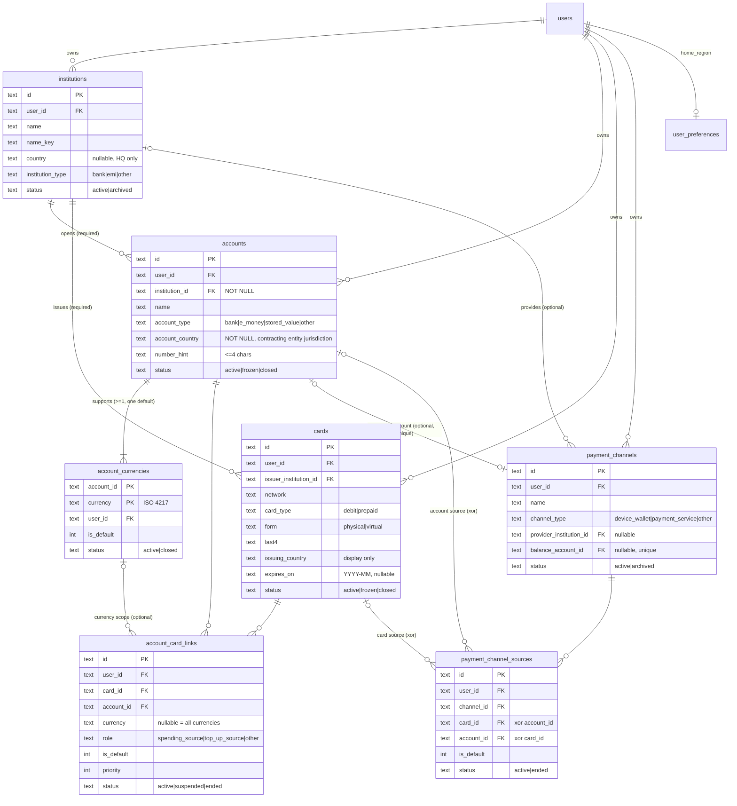
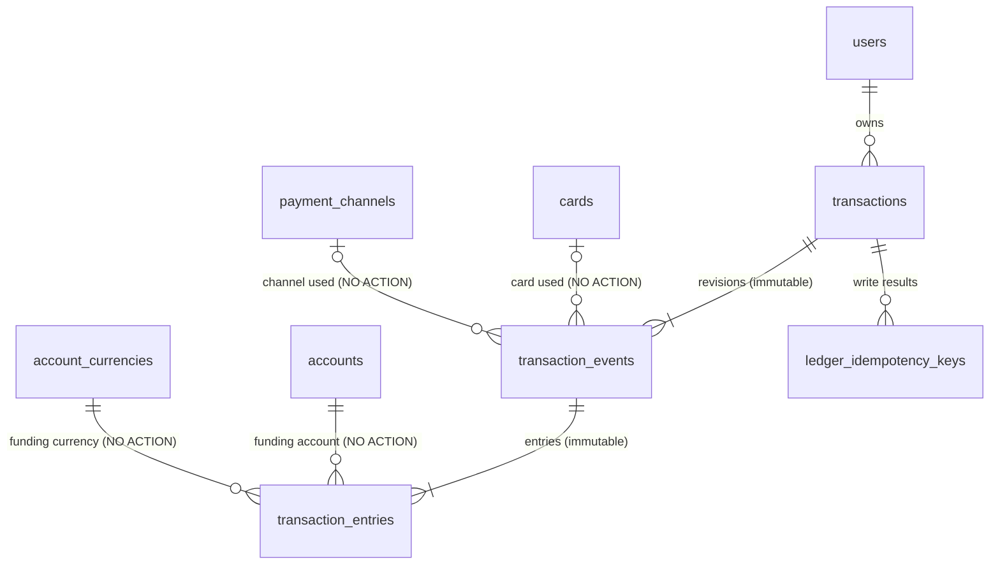

# X-UI Product v1 — 数据模型（DATA_MODEL）

> 状态：M1 表已实现；**M2 表已由迁移 `0001_m2_accounts` 实现（M2-B1，含 B1 加固：`user_preferences`、审计保留策略、`expires_on`、余额账户触发器）**；M2 API：机构（M2-B2.1）、账户及其币种（M2-B2.2）与个人设置 `home_region`（M2-B2.3）、银行卡（M2-B3，复用 `cards` 表，无数据库变更）、银行卡-账户关联与默认消费来源推荐（M2-B4，复用 `account_card_links` 表，无数据库变更）、支付渠道及其资金来源（M2-B5，复用 `payment_channels`、`payment_channel_sources` 表，无数据库变更）已实现。
> **M3（交易账本）数据模型已定稿：§10**（M3-A → M3-A.1 → M3-A.2，P1–P9 已获用户批准，见 [M3_DECISIONS.md](M3_DECISIONS.md)）；迁移 `0002_m3_transactions` 已由 M3-B1 实施（四张表、索引、21 个触发器），并在 libSQL 与本地 D1 完成验收；交易 API 尚未实现（M3-B2 起）。§8 是 M2 时期对 M3 的要求，保留原文，以 §10 为实施依据。
> 相关文档：[PRODUCT_SPEC.md](PRODUCT_SPEC.md) · [API_SPEC.md](API_SPEC.md) · [TEST_PLAN.md](TEST_PLAN.md) · [M3_DECISIONS.md](M3_DECISIONS.md)

## 1. 通用约定

- 数据库：本地 `data/x-ui-v1.db`（libsql），Cloudflare 预留 D1 `x-ui-v1`。迁移记录表 `__xui_v1_migrations`；每次启动先做数据库身份检查（`xui_v1_meta.db_identity = x-ui-product-v1`），再执行迁移。
- 主键 `id`：text，可按时间排序的随机 id。时间戳：epoch 毫秒（integer）。业务日期：`YYYY-MM-DD`（text）。年月：`YYYY-MM`（text）。布尔：integer 0/1。
- 每张业务表都有 `user_id`（→ `users.id`，`ON DELETE CASCADE`），所有查询按 `user_id` 限定；访问他人数据一律返回 404。
- **跨用户关联在数据库层禁止**：被引用的业务表都有 `UNIQUE(id, user_id)`，所有业务引用都用包含 `user_id` 的复合外键（见 §4）。
- 枚举同时以数据库 `CHECK` 与 zod 枚举约束；信用卡、投资类型在数据库层无法写入。
- 国家/地区：ISO 3166-1 alpha-2；币种：ISO 4217（排除 XAU、XAG、XPT、XPD、XTS、XXX 等非流通代码）。清单放在 `@xui/ledger-shared`。
- `name_key`：名称规范化值 = NFKC → trim → 连续空白合并为一个空格 → 小写，用于重名判断。
- 兼容 D1：不使用交互式事务，多行写入用 `db.batch()`（原子）；单条语句不超过 100 个绑定参数。
- 外键要求 `PRAGMA foreign_keys = ON`（M1 的连接已开启；D1 默认强制外键）。

## 2. M1 已有表（不变）

| 表 | 说明 |
|---|---|
| `xui_v1_meta` | 数据库身份标记 |
| `users`、`passkeys`、`sessions`、`recovery_codes`、`login_attempts`、`auth_challenges`、`audit_log` | 认证，与旧版结构兼容 |
| `settings` | 键值设置（`key` 主键，`value` JSON，`updated_at`） |

`settings` 只保存实例级（全局）设置，**不保存任何用户个人设置**。用户的 `home_region` 保存在 `user_preferences`（§3.0），每个用户独立。

`audit_log` 保持 M1 结构不变（`user_id` 无外键），其保留策略见 §6.1。

## 3. M2 表定义

### 3.0 `user_preferences` 用户个人设置

| 字段 | 类型 | 空 | 默认 | 约束 / 说明 |
|---|---|---|---|---|
| user_id | text | 否 | | 主键；→ users（CASCADE） |
| home_region | text | 否 | `'CN'` | 用户本国地区，ISO alpha-2；`CHECK(home_region GLOB '[A-Z][A-Z]')` |
| created_at, updated_at | integer | 否 | | |

每个用户至多一行；没有记录时按默认值（`CN`）处理，首次修改时创建（读取默认值不写入）。API 的 `isDefault` 由"是否存在该行"推导，不是数据库字段；保存与当前生效值相同的地区不写入（API_SPEC §3.1）。修改只影响之后新建的 M3 流水（M3 保存快照），不回写历史。

历史规则（M2-B2.3 起明确，M3 实现）：

1. M3 保存流水时，把**交易发生时**（保存时）该用户的 `home_region` 复制到 Event 的 `home_region` 快照列（§8.1）。
2. 修改 `user_preferences.home_region` **不得**改变任何已存在流水的 `home_region` 快照；不提供、也不自动执行任何回写或批量重分类。
3. 历史交易的境外判断只读取流水自身的快照，**不得**用当前的 `home_region` 重新解释。

M3 定稿时经用户批准的两项例外（§10.9；不改变以上三条对"修改设置"的约束）：
- **P4 补录声明**：`record_mode = 'backfill'` 的新交易可由用户显式声明当时的本国地区（`home_region_source = 'user_declared'`），该值与当前 `user_preferences` 无关、不读取也不写入设置。
- **P5 逐笔快照更正**：用户可对**单笔**交易显式提交快照更正，生成新版本（`home_region_source = 'user_corrected'`），旧版本保留。这是用户对一笔交易事实的更正，不是由设置变化触发的回写；批量更正与自动重分类仍然禁止。

### 3.1 `institutions` 金融机构

| 字段 | 类型 | 空 | 默认 | 约束 / 说明 |
|---|---|---|---|---|
| id | text | 否 | | 主键 |
| user_id | text | 否 | | → users（CASCADE） |
| name | text | 否 | | 1–80 字符 |
| name_key | text | 否 | | 规范化名称 |
| country | text | 是 | | 注册地/总部；`CHECK(country IS NULL OR country GLOB '[A-Z][A-Z]')` |
| institution_type | text | 否 | | `CHECK IN ('bank','emi','other')` |
| website | text | 是 | | `https://…`，≤200；仅展示，服务端从不访问 |
| color | text | 是 | | `#rrggbb`（头像底色，代替 logo） |
| notes | text | 是 | | ≤1000，敏感扫描 |
| status | text | 否 | `'active'` | `CHECK IN ('active','archived')` |
| sort | integer | 否 | 0 | |
| created_at, updated_at | integer | 否 | | |

索引：`UNIQUE(id, user_id)`；`UNIQUE(user_id, name_key, ifnull(country, ''))`；`INDEX(user_id, status)`。

### 3.2 `accounts` 持有资金的账户

| 字段 | 类型 | 空 | 默认 | 约束 / 说明 |
|---|---|---|---|---|
| id | text | 否 | | 主键 |
| user_id | text | 否 | | → users（CASCADE） |
| institution_id | text | **否** | | `(institution_id, user_id)` → institutions（见 §4） |
| name | text | 否 | | 1–80 |
| name_key | text | 否 | | 规范化名称（仅用于搜索与重名提示，不唯一） |
| account_type | text | 否 | | `CHECK IN ('bank','e_money','stored_value','other')` |
| deposit_kind | text | 是 | | `CHECK IN ('current','savings','fixed','other')`；`CHECK(deposit_kind IS NULL OR account_type = 'bank')` |
| account_country | text | **否** | | **开户合同所属金融机构法律实体所在法域**；`CHECK(account_country GLOB '[A-Z][A-Z]')` |
| number_hint | text | 是 | | 账号尾号，`CHECK(number_hint IS NULL OR (length(number_hint) BETWEEN 1 AND 4 AND number_hint NOT GLOB '*[^0-9A-Za-z]*'))` |
| status | text | 否 | `'active'` | `CHECK IN ('active','frozen','closed')` |
| opened_on, closed_on | text | 是 | | `YYYY-MM-DD`；`CHECK(closed_on IS NULL OR opened_on IS NULL OR closed_on >= opened_on)` |
| notes | text | 是 | | ≤1000，敏感扫描 |
| sort | integer | 否 | 0 | |
| created_at, updated_at | integer | 否 | | |

索引：`UNIQUE(id, user_id)`；`INDEX(user_id, status)`；`INDEX(user_id, institution_id)`；`INDEX(user_id, account_country)`。

**明确不存在的字段**：`balance`、`opening_balance`、`balance_date`、`credit_limit`、`include_in_total`、任何金额字段、完整账号。

**`institution_id` 创建后不可修改**：`PATCH /accounts/:id` 不接受 `institutionId`（未知字段 → 400 `VALIDATION`，服务层 `accountPatchValues` 只写入允许的列）；数据库触发器 `accounts_institution_immutable`（`BEFORE UPDATE OF institution_id`，值确有变化时 `RAISE(ABORT, 'ACCOUNT_INSTITUTION_IMMUTABLE: …')`）兜底，绕过服务层的 ORM 或原始 SQL 更新同样被拒绝（SQLite 与 D1 均验证）。删除（包括删除用户时的级联删除）不是更新，不受影响。开户法律实体发生变化时创建新账户，历史流水继续指向旧账户。

`account_country` 判定规则（冻结）：以账户协议与实际开户实体为依据；不是合作银行存放资金的地点；不从机构总部、银行卡发行国家、币种收款账户信息推断；一个账户只有一个值；开户实体变更时新建账户而非改写旧账户。

### 3.3 `account_currencies` 账户支持的币种

选用关联表而非 JSON 数组：可被复合外键引用（关联、M3 流水）、可查询"哪些账户持有某币种"、可单独关闭某币种。

| 字段 | 类型 | 空 | 默认 | 约束 |
|---|---|---|---|---|
| account_id | text | 否 | | `(account_id, user_id)` → accounts（CASCADE） |
| user_id | text | 否 | | → users（CASCADE） |
| currency | text | 否 | | `CHECK(currency GLOB '[A-Z][A-Z][A-Z]')` + ISO 清单 |
| is_default | integer | 否 | 0 | `CHECK IN (0,1)` |
| status | text | 否 | `'active'` | `CHECK IN ('active','closed')`；`CHECK(is_default = 0 OR status = 'active')` |
| sort | integer | 否 | 0 | |
| created_at | integer | 否 | | |

主键 `(account_id, currency)`；`UNIQUE(account_id, user_id, currency)`（复合外键的目标）；`UNIQUE(account_id) WHERE is_default = 1`。
API 保证：每个账户至少一个币种，恰好一个默认币种（且为 active）。无余额字段。

### 3.4 `cards` 银行卡

| 字段 | 类型 | 空 | 默认 | 约束 / 说明 |
|---|---|---|---|---|
| id | text | 否 | | 主键 |
| user_id | text | 否 | | → users（CASCADE） |
| issuer_institution_id | text | 否 | | `(issuer_institution_id, user_id)` → institutions |
| name | text | 否 | | 1–80，敏感扫描 |
| network | text | 否 | | `CHECK IN ('visa','mastercard','amex','unionpay','jcb','discover','diners','maestro','other')` |
| card_type | text | 否 | | `CHECK IN ('debit','prepaid')` —— 数据库层禁止信用卡 |
| form | text | 否 | `'physical'` | `CHECK IN ('physical','virtual')` |
| last4 | text | 否 | | `CHECK(last4 GLOB '[0-9][0-9][0-9][0-9]')` |
| issuing_country | text | 否 | | ISO alpha-2；仅展示，**不得用于推断资金所在地** |
| expires_on | text | 是 | | `YYYY-MM`，月份 01–12；`CHECK(expires_on IS NULL OR expires_on GLOB '[0-9][0-9][0-9][0-9]-0[1-9]' OR expires_on GLOB '[0-9][0-9][0-9][0-9]-1[0-2]')` |
| status | text | 否 | `'active'` | `CHECK IN ('active','frozen','closed')` |
| notes | text | 是 | | ≤1000，敏感扫描 |
| sort | integer | 否 | 0 | |
| created_at, updated_at | integer | 否 | | |

索引：`UNIQUE(id, user_id)`；`INDEX(user_id, status)`；`INDEX(user_id, issuer_institution_id)`。

**明确不存在的字段**：`account_id`、`pan`、`pan_enc`、`bin`、`bin_info`、`cvv`、`pin`、`holder_name`、`credit_limit`、`statement_day`、`due_day`。

`expires_on` 的语义（M2-B3 明确）：卡片有效至该月最后一天（含当天）；"已过期 / 即将到期"在读取时按调用方的日历日期推导（`@xui/ledger-shared` 的 `expiry.ts`，API_SPEC §3.4 实现说明），不存储，也不改变 `status`。表中没有卡片颜色、发卡日期列；卡面颜色取发卡机构的 `color`。

### 3.5 `account_card_links` 银行卡-账户关联（多对多）

| 字段 | 类型 | 空 | 默认 | 约束 / 说明 |
|---|---|---|---|---|
| id | text | 否 | | 主键 |
| user_id | text | 否 | | → users（CASCADE） |
| card_id | text | 否 | | `(card_id, user_id)` → cards（CASCADE） |
| account_id | text | 否 | | `(account_id, user_id)` → accounts（CASCADE） |
| currency | text | 是 | | 空 = 适用于账户所有币种；非空时 `(account_id, user_id, currency)` → account_currencies |
| role | text | 否 | `'spending_source'` | `CHECK IN ('spending_source','top_up_source','other')` |
| is_default | integer | 否 | 0 | `CHECK(is_default = 0 OR (role = 'spending_source' AND status = 'active'))` |
| priority | integer | 是 | | 扣款顺序，1 最先；`CHECK(priority IS NULL OR priority >= 1)` |
| status | text | 否 | `'active'` | `CHECK IN ('active','suspended','ended')` |
| started_on, ended_on | text | 是 | | `YYYY-MM-DD`；`CHECK(ended_on IS NULL OR status = 'ended')` |
| notes | text | 是 | | ≤1000，敏感扫描 |
| created_at, updated_at | integer | 否 | | |

索引：
- `UNIQUE(card_id, account_id, ifnull(currency, ''), role) WHERE status <> 'ended'` —— 同一组合不能有两条未结束关联；结束后可重新关联。
- `UNIQUE(card_id, ifnull(currency, '')) WHERE is_default = 1` —— 每张卡每个币种范围至多一个默认消费来源。
- `INDEX(user_id, card_id)`；`INDEX(user_id, account_id)`。

用途定义：
- `spending_source`：刷卡消费时扣款的账户。**预付卡的储值账户是该卡的 `spending_source`。**
- `top_up_source`：为卡（或其储值账户）充值的账户。不可设为默认消费来源。
- `other`：其他关系，仅作记录。

生命周期：创建 → `active` ⇄ `suspended` → `ended`（"解除关联"，保留历史，不可恢复，需重新建立）。`DELETE` 仅用于纠正误录。账户、银行卡状态变化**不修改**关联的状态或默认标记；默认来源查找在读取时过滤状态（§5）。

M2-B4 实现说明（无数据库变更）：`card_id`、`account_id`、`currency` 建立后不再修改（API 不提供）；已结束的关联只能修改 `notes`。`account_card_links_open_uq` 与 `account_card_links_default_uq` 不含 `user_id`（`card_id` 全局唯一，已足够），因此 API 在报告 `DUPLICATE` 之前先确认卡与账户属于当前用户，另一用户的相同关联不会以 409 暴露。默认关系的唯一性由服务端（batch：先清除同范围旧默认、再设置，两步都以目标仍为 active 的 `spending_source` 为条件）与部分唯一索引共同维护；`is_default` 的 CHECK 保证只有 active 的 `spending_source` 能是默认，暂停、结束或改用途时服务端同时清零。细节见 API_SPEC §3.5 实现说明。

### 3.6 `payment_channels` 支付渠道

| 字段 | 类型 | 空 | 默认 | 约束 / 说明 |
|---|---|---|---|---|
| id | text | 否 | | 主键 |
| user_id | text | 否 | | → users（CASCADE） |
| name | text | 否 | | 1–80，敏感扫描 |
| name_key | text | 否 | | `UNIQUE(user_id, name_key)` |
| channel_type | text | 否 | | `CHECK IN ('device_wallet','payment_service','other')` |
| provider_institution_id | text | 是 | | `(provider_institution_id, user_id)` → institutions |
| balance_account_id | text | 是 | | `(balance_account_id, user_id)` → accounts；`CHECK(balance_account_id IS NULL OR channel_type = 'payment_service')` |
| region | text | 是 | | 服务账户注册地区，仅展示；ISO alpha-2 |
| status | text | 否 | `'active'` | `CHECK IN ('active','archived')` |
| notes | text | 是 | | ≤1000，敏感扫描 |
| sort | integer | 否 | 0 | |
| created_at, updated_at | integer | 否 | | |

索引：`UNIQUE(id, user_id)`；`UNIQUE(user_id, name_key)`；`UNIQUE(balance_account_id) WHERE balance_account_id IS NOT NULL`；`INDEX(user_id, status)`。

余额账户的 `account_type` 须为 `e_money` 或 `stored_value`：API 校验（400 `BALANCE_ACCOUNT_KIND`），数据库由三个触发器兜底（SQLite 与 D1 均验证）：
- `payment_channels_balance_kind_insert`：INSERT 渠道时检查；
- `payment_channels_balance_kind_update`：UPDATE 渠道的 `balance_account_id` 或 `user_id` 时检查；
- `accounts_balance_kind_update`：被用作余额账户的账户不能改为其他类型（先解除余额账户）。

违反时 `RAISE(ABORT, 'BALANCE_ACCOUNT_KIND: …')`。账户不存在或属于其他用户时触发器不触发，由复合外键拒绝。

转账方式（SWIFT、FPS、SEPA 等）不是支付渠道，属于 M3 交易模型。

### 3.7 `payment_channel_sources` 支付渠道资金来源

| 字段 | 类型 | 空 | 默认 | 约束 / 说明 |
|---|---|---|---|---|
| id | text | 否 | | 主键 |
| user_id | text | 否 | | → users（CASCADE） |
| channel_id | text | 否 | | `(channel_id, user_id)` → payment_channels（CASCADE） |
| card_id | text | 是 | | `(card_id, user_id)` → cards（CASCADE） |
| account_id | text | 是 | | `(account_id, user_id)` → accounts（CASCADE） |
| is_default | integer | 否 | 0 | `CHECK(is_default = 0 OR status = 'active')` |
| status | text | 否 | `'active'` | `CHECK IN ('active','ended')` |
| notes | text | 是 | | ≤1000，敏感扫描 |
| created_at, updated_at | integer | 否 | | |

约束：`CHECK((card_id IS NULL) <> (account_id IS NULL))`；`UNIQUE(channel_id, card_id) WHERE card_id IS NOT NULL AND status = 'active'`；`UNIQUE(channel_id, account_id) WHERE account_id IS NOT NULL AND status = 'active'`；`UNIQUE(channel_id) WHERE is_default = 1`；`INDEX(user_id, channel_id)`。
API 规则：`device_wallet` 的来源只能是银行卡。

M2-B5 实现说明（§3.6、§3.7，无数据库变更）：
- 支付渠道不是资产账户：没有余额或金额列，也不计算任何余额；资金始终在 `accounts` 中。渠道、余额账户（前端称"资金账户"）、来源（银行卡或账户）与转账方式（SWIFT、FPS、SEPA 等，M3）相互独立。
- 余额账户：仅 `payment_service`（`CHECK`），类型 `e_money` / `stored_value`（三个触发器），一个账户至多被一个渠道使用（`payment_channels_balance_account_uq`）。该唯一索引不含 `user_id`（`balance_account_id` 全局唯一已足够，复合外键保证同一用户），因此 API 在报告 `DUPLICATE` 之前先确认账户属于当前用户，另一用户的账户（即使正被其渠道使用）与不存在的账户同样返回 404。
- 来源：`device_wallet` 只能挂银行卡由 API 在写入语句中保证（`INSERT … SELECT … FROM payment_channels WHERE channel_type <> 'device_wallet'`），渠道改为设备钱包时同样在 `UPDATE … WHERE NOT EXISTS (账户来源)` 中检查（已结束的账户来源同样阻止：历史保持原有含义，提示新建设备钱包渠道并归档旧渠道，不要求删除历史），二者在 SQLite / D1 的串行写入下互斥。来源的 `channel_id`、`card_id`、`account_id` 建立后不再修改（API 不提供）。
- 生命周期：来源 `active` → `ended`（结束，保留历史，清除默认，不可恢复——规格未定义恢复；需要时作为新记录重新添加，部分唯一索引只约束 `active` 记录）；`DELETE` 仅用于纠正误录。渠道 `active` ⇄ `archived`，归档不修改任何来源。银行卡、账户的冻结 / 关闭不修改来源；删除银行卡或账户级联删除其来源（§4），被用作余额账户的账户不能删除；删除渠道级联删除其全部来源，不影响银行卡、账户与余额账户。
- 默认来源：每个渠道至多一个（`payment_channel_sources_default_uq` 为最后防线）。设默认是一个 batch：先清除同渠道的旧默认、再设置新默认，两条语句都以目标仍为 `active` 为条件；任一失败整体回滚，不会出现默认丢失或两个默认。
- `payment_channels_balance_ck` 与 API 的合并检查共同保证"改类型时不能保留余额账户"；`payment_channel_sources_default_ck` 保证已结束的来源不能是默认。

## 4. 复合外键矩阵（数据隔离）

所有业务引用都包含 `user_id`，父表侧有对应唯一键。即使应用层校验遗漏，数据库也拒绝跨用户关联。

| 子表 | 子列 | 父表（唯一键） | ON DELETE |
|---|---|---|---|
| user_preferences | user_id | users(id) | CASCADE |
| institutions | user_id | users(id) | CASCADE |
| accounts | (institution_id, user_id) | institutions(id, user_id) | NO ACTION |
| account_currencies | (account_id, user_id) | accounts(id, user_id) | CASCADE |
| cards | (issuer_institution_id, user_id) | institutions(id, user_id) | NO ACTION |
| account_card_links | (card_id, user_id) | cards(id, user_id) | CASCADE |
| account_card_links | (account_id, user_id) | accounts(id, user_id) | CASCADE |
| account_card_links | (account_id, user_id, currency) | account_currencies(account_id, user_id, currency) | NO ACTION |
| payment_channels | (provider_institution_id, user_id) | institutions(id, user_id) | NO ACTION |
| payment_channels | (balance_account_id, user_id) | accounts(id, user_id) | NO ACTION |
| payment_channel_sources | (channel_id, user_id) | payment_channels(id, user_id) | CASCADE |
| payment_channel_sources | (card_id, user_id) | cards(id, user_id) | CASCADE |
| payment_channel_sources | (account_id, user_id) | accounts(id, user_id) | CASCADE |

此外，上表每个子表都有自己的 `user_id → users(id) ON DELETE CASCADE`。M3 新增的外键见 §10.6。

说明：
- **限制删除用 `NO ACTION`，不用 `RESTRICT`。** `RESTRICT` 在父行删除的瞬间检查，会与同一语句中的级联删除冲突（例如删除用户时级联删除机构，而账户尚未被级联删除；或删除账户时级联删除币种，而关联尚未被级联删除）。`NO ACTION` 在语句结束时检查，级联完成后不再有残留引用即通过；单独删除仍被引用的父行则失败。API 在删除前先检查引用并返回 409，数据库约束是最后防线。
- **复合外键只配合 `CASCADE` 或 `NO ACTION`**，不使用 `SET NULL`（会把 `user_id` 一并置空，违反 NOT NULL）。
- 子列中任一列为 NULL 时（如 `currency`、`card_id`、`provider_institution_id`），SQLite 不检查该外键（MATCH SIMPLE），符合"可选引用"的语义。
- 删除行为汇总：
  - 机构：被账户、银行卡、支付渠道引用时不可删除 → 归档。
  - 账户：级联删除其币种、银行卡关联、渠道来源；被支付渠道用作余额账户时不可删除；M3 起被流水引用时不可删除 → 关闭。
  - 银行卡：级联删除其关联、渠道来源；M3 起被流水引用时不可删除 → 关闭。
  - 账户币种：被关联引用时不可删除 → 关闭该币种。
  - 支付渠道：级联删除其来源；M3 起被流水引用时不可删除 → 归档。
  - 用户：v1 不提供删除用户的接口；在数据库层删除用户时，所有带 `user_id → users(id) ON DELETE CASCADE` 的表（认证表、`user_preferences` 与 M2 表）中该用户的记录全部级联删除，不影响其他用户，且删除后 `PRAGMA foreign_key_check` 为空；`audit_log` 按 §6.1 保留（TEST_PLAN D-3）。
- 关闭与删除的区别：
  - 关闭/冻结账户、关闭账户币种、冻结/关闭银行卡**不修改任何关联**（状态与默认标记保留，历史可查），只是这些来源不再被推荐（§5）；恢复有效后重新可被推荐。
  - 删除只用于没有历史意义的记录；被余额渠道或（M3 起）历史流水引用的账户不能删除。

## 5. 默认消费来源推荐（只读，供 M3 预填）

输入：银行卡 `card`、**Event 消费币种** `C`。
输出：三种结果之一 —— `exact_currency`、`conversion_required`、`no_match`。

```
if card.status != 'active':
    return { match: 'no_match', eventCurrency: C, reason: 'card_inactive' }

-- 合格：银行卡（上一步）、关联、账户、币种的状态全部有效
eligible(link) :=
      link.role   = 'spending_source'
  AND link.status = 'active'
  AND account(link).status = 'active'
  AND scope(link) is not empty

-- 关联可用的扣款币种（只含 active 币种）
scope(link) :=
  [link.currency]                         if link.currency IS NOT NULL and that account currency is active
  []                                      if link.currency IS NOT NULL and that account currency is closed
  active currencies of account(link)      if link.currency IS NULL

rank := is_default DESC,
        (link.currency IS NOT NULL) DESC,   -- 币种专属关联优先于"所有币种"关联
        priority ASC NULLS LAST,
        created_at ASC

1. exact := eligible links where C ∈ scope(link), ordered by rank
   if exact not empty:
     return { match: 'exact_currency', eventCurrency: C,
              accountId, linkId, fundingCurrency: C }

2. conv := eligible links, ordered by rank
   if conv not empty:
     return { match: 'conversion_required', eventCurrency: C,
              accountId, linkId, fundingCurrency: null,
              candidateCurrencies: scope(link)   -- 账户默认币种排在最前，其余按 sort
            }

3. return { match: 'no_match', eventCurrency: C, reason: 'no_eligible_link' }
```

规则：
- **不把账户默认币种当作消费币种或扣款币种。** `conversion_required` 的 `fundingCurrency` 永远为 `null`；`candidateCurrencies` 只是候选，用户必须依据真实交易记录选择扣款币种并填写扣款金额（§8）。
- **币种一致优先于默认标记。** 任何合格的币种一致来源，都优先于需要换汇的默认来源。理由是多币种卡（如 Wise）通常优先扣同币种余额。这只是推荐，用户可以改。
- 冻结或关闭的银行卡、账户，已关闭的账户币种，以及暂停或已结束的关联，永远不会被推荐。被跳过的默认关联不报错，继续按顺序查找。
- 推荐结果不写入任何数据；M3 流水保存用户最终确认的值（§8）。
- M2-B4 实现（`apps/ledger-api/src/services/cardLinks.ts` 的 `recommendSpendingSource`，纯函数）：`rank` 末尾另加 `id ASC`，使同一毫秒创建的关联也有确定顺序；到期（`expires_on`）不影响推荐，只看 `status`；响应另带 `considered`（每条未结束关联的合格性、可用币种与不合格原因，按决策顺序），见 API_SPEC §3.4.1 实现说明。

示例（Wise 多币种账户 + Wise 借记卡，一条"所有币种"默认关联）：

| 账户有效币种 | 消费币种 | 结果 |
|---|---|---|
| USD、EUR、GBP | USD | `exact_currency`：Wise · USD |
| HKD（默认）、EUR | USD | `conversion_required`：Wise，`fundingCurrency = null`，候选 `[HKD, EUR]` |
| HKD（默认）、EUR，账户已冻结 | USD | `no_match`（`no_eligible_link`） |
| 任意，银行卡已冻结 | 任意 | `no_match`（`card_inactive`） |

## 6. 敏感数据防护

1. 请求体使用 zod `.strict()`：出现未知字段（`pan`、`cardNumber`、`number`、`cvv`、`cvc`、`pin`、`bin` 等）→ 400。
2. 自由文本字段（所有 `name`、`notes`、`number_hint`）扫描：
   - 13–19 位数字（允许其间有空格或 `-`）且通过 Luhn 校验 → `400 SENSITIVE_DATA`；
   - `cvv|cvc|cvv2|pin|安全码|密码` 后接 3–6 位数字 → `400 SENSITIVE_DATA`。
   - **无绕过参数或确认选项。**
   - 实现（`@xui/ledger-shared` 的 `scanSensitive`，API 与前端共用）：先做 NFKC（全角数字同样命中）；数字组之间允许 1–2 个空格或 `-`，对连续若干组合计 13–19 位的每个组合做 Luhn 检查（"ref 12 4111 1111 1111 1111" 同样命中）；`cvv`/`cvc`/`cvv2`/`pin` 需为独立单词（"spin 1234" 不命中）。机构的 `website` 也做扫描。
3. 表结构中不存在 PAN、BIN、CVV、PIN、持卡人姓名、完整账号、余额相关列（由测试扫描 schema 保证）。
4. 不记录请求体日志；审计日志 detail 只含 id 与后四位。

### 6.1 审计日志保留策略

- `audit_log` 是独立的安全记录，表结构沿用 M1、不做修改；`user_id` 不设外键。
- **删除用户不删除其审计记录**：记录保留原 `user_id`（此后指向已不存在的用户），用于事后追查；不随用户、账户、银行卡等业务数据级联删除。
- v1 不自动清理审计记录；如需清理，只能作为单独的运维操作，不属于任何业务删除流程。
- 内容限制：只记录动作、相关 id、后四位、名称等非敏感信息与 IP；**不得包含**密码、TOTP 密钥或验证码、恢复码、会话令牌、加密密钥、PAN / CVV / PIN 或请求体（测试：`audit-retention.test.ts`）。
- 登录相关事件**不记录用户输入的原文**：`login.failure` 只记录 `{ via }`，已存在的账户通过 `user_id` 标识；`login.locked` 只记录触发的限制范围 `{ scopes: ['user', 'ip'] }`，不记录限流键的值（用户键含输入的用户名，可能是误输入的密码）。时间与 IP 由每条审计记录自带（测试：`audit-retention.test.ts` 用唯一的"金丝雀"字符串作为用户名验证）。
- 登录限流表 `login_attempts`（M1 表，结构不变）的按用户名计数键为 `user:<hex HMAC-SHA256(SESSION_PEPPER, "x-ui-v1/login-attempts/user:" + 小写用户名)>`，不保存输入的用户名原文；IP 计数键仍为 `ip:<IP>`（IP 不是凭证）。规范化（小写）、阈值（用户名 5 次 / IP 30 次）、15 分钟窗口与 15 分钟锁定均不变；轮换 `SESSION_PEPPER` 会重置按用户名的计数。

## 7. ER 图



## 8. M3 数据模型要求（Event / Entry 与历史完整性）

M3 的具体表名与其余字段在 M3 设计时确定；以下是 M2 对 M3 的硬性要求。暂称 `transaction_events`（Event）与 `transaction_entries`（Entry），一个 Event 至少一个 Entry。

> **M3 定稿说明**：本节保留 M2 原文作为约束来源；正式定义见 §10，实施以 §10 为准。§10 全部满足本节要求，另有经批准的细化与例外：表名沿用 `transaction_events`、`transaction_entries`，另加交易头 `transactions` 与 `ledger_idempotency_keys`（K5）；Event 按版本保存、不可修改；Entry 增加 `direction`，入账方向的 `funding_*` 指入账账户与币种（K2）；Entry 指向 Event 的外键为 `(event_id, txn_type, user_id)`，仍为 CASCADE；`event_amount` 仅在他人汇入且对方金额未知时可空（P8，§10.3.1）；已关闭币种在历史补录与沿用时受控可用（P7，§10.9.4），因此 PRODUCT_SPEC §6.1 第 5 条与 TEST_PLAN M3-10 的"有效币种"要求按 §10.9.4 执行。

### 8.1 Event：原始交易

| 字段 | 说明 |
|---|---|
| `event_currency` | 原始消费币种（ISO 4217），例如商户标价的 USD |
| `event_amount` | 原始金额（该币种最小单位整数） |
| `merchant_country` | 商户所在地（M3 定义） |
| `card_id` | 实际使用的银行卡（可空）；复合外键 `(card_id, user_id)` → cards，NO ACTION |
| `payment_channel_id` | 实际使用的支付渠道（可空）；复合外键 `(payment_channel_id, user_id)` → payment_channels，NO ACTION |
| `transfer_method` | 转账方式（SWIFT、FPS、SEPA 等，M3 定义；替代原 `bank_transfer` 渠道类型） |
| `home_region` | **快照**：保存时该用户 `user_preferences.home_region` 的值（无记录时为 `CN`）；之后修改设置不改变此列，历史判断只读此列（§3.0） |

### 8.2 Entry：资金实际变动

| 字段 | 说明 |
|---|---|
| `event_id` | 复合外键 `(event_id, user_id)` → events，CASCADE |
| `funding_account_id` | 真实资金来源账户；复合外键 `(funding_account_id, user_id)` → accounts，NO ACTION |
| `funding_currency` | **实际扣款币种**；复合外键 `(funding_account_id, user_id, funding_currency)` → account_currencies，NO ACTION |
| `amount` | **实际扣款金额**（`funding_currency` 最小单位整数）；可空 |
| `amount_status` | `CHECK IN ('confirmed','pending')`；`CHECK((amount IS NULL) = (amount_status = 'pending'))` |
| `funding_account_country` | **快照**：保存时该账户的 `account_country` |

示例（Wise 卡支付 10 USD，实际从 HKD 余额扣款）：

| 层 | 字段值 |
|---|---|
| Event | `event_currency = USD`，`event_amount = 1000`，`card_id = Wise Debit` |
| Entry | `funding_account_id = Wise 多币种账户`，`funding_currency = HKD`，`amount = 7830`（用户依据 Wise 记录填写），`amount_status = confirmed`，`funding_account_country = BE` |

### 8.3 规则

1. **不自动计算汇率与手续费**：不保存推算汇率，不生成换算合计；`event_amount` 与 `amount` 是两个独立事实。
2. Entry 币种与 Event 币种相同时，前端可预填 `amount = event_amount`，但仍分别保存。
3. 币种不同时，`amount` 由用户依据真实交易记录填写；未知时为 `pending`，不估算，不计入金额统计，单独列出待补录。
4. 金额统计与境外活动判断按 Entry（资金账户、币种、金额、`funding_account_country`）与 Event 快照（`home_region`、`merchant_country`）进行；Event 金额不另行计入统计，避免重复。
5. 默认来源推荐（§5）只用于新建时预填；`conversion_required` 时 `funding_currency` 必须由用户选择。保存后只读取流水自身字段，**不依据当前关联关系重算**。
6. 修改 `account_country`、修改 `home_region`、结束或删除关联、关闭账户/银行卡/币种，**不改变任何已保存的 Event、Entry 及其统计结果**；系统不会自动回写历史。
7. 被流水引用的账户、账户币种、银行卡、支付渠道不可删除（API 返回 409，只能关闭/归档）；对应外键使用 `NO ACTION`。

## 9. 迁移与实现注意

- 迁移 `0001_m2_accounts.sql` 只新建 §3 的八张表（含 `user_preferences`）、其索引与四个触发器（§3.6 的三个余额账户触发器、§3.2 的 `accounts_institution_immutable`），不修改 M1 表；仍经过 M1 的身份检查，只在 v1 数据库上执行。
- drizzle-kit 0.31 会把表达式索引列 `ifnull("col", '')` 拆开并加引号（"no such column"），且不支持触发器：0001 在生成后手工修正，文件头注明修改内容。`test/migrations-guard.test.ts` 扫描**所有** v1 迁移：引号标识符、表达式索引、括号、空语句、journal / SQL / 快照一致、wrangler 拆分结果与 drizzle 一致、整条迁移链可在空库执行且必需触发器存在。
- 表达式部分唯一索引（`ifnull(...)` + `WHERE`）与复合外键需在 M2-B 验证 drizzle-kit 的生成结果，必要时手工修改迁移 SQL，并以测试确认索引与约束确实生效。
- "设为默认"等多行更新使用 `db.batch()` 原子执行（先清除同范围旧默认，再设置新默认）；部分唯一索引作为最后防线。
- 共享 zod schema、DTO 类型、ISO 国家与币种清单放在新包 `packages/ledger-shared`（`@xui/ledger-shared`），不修改 `@z-ui/shared`。
- **SQLite 与 D1 双环境验证**：`NO ACTION`、`CASCADE`、复合外键、部分唯一索引、表达式索引、CHECK 与 `db.batch()` 原子性，必须在两个环境中用同一套用例验证（TEST_PLAN §3.12）：
  - 本地 SQLite：libsql 文件数据库，经 `openV1Db()`（身份检查 + 迁移），连接上已开启 `PRAGMA foreign_keys = ON`；
  - 本地 D1：wrangler `getPlatformProxy()` 启动的 workerd 内存 D1（`persist: false`、`remoteBindings: false`），迁移按 `_journal.json` 顺序、用 wrangler 的 SQL 拆分器逐条执行，与 `wrangler d1 migrations apply` 一致；**不连接远程 D1**。
  - 两个环境都先用一条明显非法的外键插入确认外键确实在强制执行，避免"约束未开启"导致的假通过。

## 10. M3 数据模型（正式定义）

> 依据：M3-A.2 为准，未覆盖处继承 M3-A.1、M3-A；P1–P9 已获用户批准（[M3_DECISIONS.md](M3_DECISIONS.md)）。产品规则见 PRODUCT_SPEC §7，接口见 API_SPEC §5，测试见 TEST_PLAN §5。本节是迁移 `0002_m3_transactions`（M3-B1）与写入服务（M3-B2、B3）的实施依据。
> **验证状态**：§10.13 所列关键机制已由 M3-B1 在 libSQL 与本地 D1 上全部验证通过（DB-M3-0 探针 `test/m3-db-probe.test.ts`，约束与写入链 `m3-schema.test.ts`、`m3-chains.test.ts`）。**M3-B2 已实现**：§10.10 的新建写入链（`services/transactionWrite.ts`）与 batch 之后的路由处理、受控重试（`services/transactionCreate.ts`），列表与详情只读当前版本（§10.1），§10.11 L5 的 API 删除保护与账户删除审计同 batch；更正、作废链待 M3-B3，§10.12 统计待 M3-B5。§10.4、§10.5、§10.9、§10.10 已按 M3-B3-A 复审决定（Q-B3-2、Q-B3-3、Q-B3-4、Q-B3-8、Q-B3-11）在 M3-B3-B.0 细化：更正 / 作废键的逻辑过期与统一时间基准、各版本种类的字段继承（小数位、`closed_currency_ack`）、更正与作废链的写法、`TRANSACTION_VOIDED` 优先、受控重试的来源集合；迁移 `0002` 不变，不新增 `0003`。

### 10.1 总览与约定



- 四张新表：`transactions`（交易头：身份、状态、当前版本、备注、作废信息；唯一可更新的表，且只能按 §10.7.2 的方式更新）→ `transaction_events`（Event：交易某一版本的原始事实，写入后不可修改）→ `transaction_entries`（Entry：该版本中一个真实账户的资金变动，写入后不可修改）；`ledger_idempotency_keys`（财务写操作的完成结果，只插入）。
- 沿用 §1 的约定：text 时间排序 id、epoch 毫秒时间戳、`YYYY-MM-DD` 业务日期、每表 `user_id → users(id) ON DELETE CASCADE`、复合外键与 `UNIQUE(id, user_id)`、CHECK 与 zod 双重约束、只用 `db.batch()`、单条语句 ≤ 100 个绑定参数、batch 中只用 drizzle 查询构造器（D1 batch 不能绑定 `db.run(sql\`\`)`）。
- 列表与统计只读取 **`status = 'active'` 交易的当前版本**（`transaction_events.revision = transactions.current_revision`）；被取代的版本与已作废交易只出现在历史中。
- **金额**：该币种最小单位的正整数，`1 ≤ amount ≤ 999 999 999 999 999`（低于 2^53）；`0`、负数、小数一律拒绝（数据库 `CHECK(typeof(x) = 'integer' AND x BETWEEN 1 AND 999999999999999)`）。方向由 `direction` 表示，不使用负数。每个金额旁保存小数位快照（`*_exponent`，0–4），取自 `@xui/ledger-shared` 的 ISO 4217 最小单位表（来源与 §1 币种清单相同：SIX List One 的 `CcyMnrUnts`）；ISO 将来修改某币种小数位时历史金额不受影响。
- 文本长度沿用 M2 约定：名称类 1–80，原因类 ≤ 200，备注 ≤ 1000；全部做敏感信息扫描（§6）。对方账号只允许尾号（与 `accounts.number_hint` 相同的 CHECK），不保存完整账号或 IBAN。

### 10.2 `transactions` 交易头

| 字段 | 类型 | 空 | 默认 | 约束 / 说明 |
|---|---|---|---|---|
| id | text | 否 | | 主键 |
| user_id | text | 否 | | → users（CASCADE） |
| txn_type | text | 否 | | `CHECK IN ('merchant_spend','merchant_refund','own_transfer','third_party_transfer')`；建立后不可修改 |
| status | text | 否 | `'active'` | `CHECK IN ('active','voided')`；作废为终态 |
| current_revision | integer | 否 | 0 | `CHECK(current_revision >= 0)`；0 = 尚未发布（只在写入 batch 内短暂存在） |
| notes | text | 是 | | 备注，≤1000，敏感扫描；**不属于交易事实**，可随时修改（含作废后），不保留修改历史（P9） |
| voided_at | integer | 是 | | |
| void_reason | text | 是 | | ≤200，敏感扫描 |
| voided_op_id | text | 是 | | 作废该交易的那次请求的 `op_id`（§10.10） |
| created_at, updated_at | integer | 否 | | `created_at` = 录入时间 |

CHECK：`(status = 'voided') = (voided_at IS NOT NULL)`；`(status = 'voided') = (voided_op_id IS NOT NULL)`；`void_reason IS NULL OR status = 'voided'`；`status = 'active' OR current_revision >= 1`。
索引：`UNIQUE(id, user_id)`；`UNIQUE(id, txn_type, user_id)`（Event 复合外键目标）；`INDEX(user_id, status)`。

### 10.3 `transaction_events` Event 版本

| 字段 | 类型 | 空 | 约束 / 说明 |
|---|---|---|---|
| id | text | 否 | 主键 |
| user_id | text | 否 | → users（CASCADE） |
| transaction_id | text | 否 | `(transaction_id, txn_type, user_id)` → transactions（CASCADE） |
| txn_type | text | 否 | 与交易头一致（由复合外键保证） |
| revision | integer | 否 | `CHECK(revision >= 1)`；`UNIQUE(transaction_id, revision)` |
| revision_kind | text | 否 | `CHECK IN ('original','settlement','fact_correction','snapshot_correction')`；`CHECK((revision = 1) = (revision_kind = 'original'))` |
| correction_reason | text | 是 | ≤200，敏感扫描；`original` 时必须为 NULL；`fact_correction`、`snapshot_correction` 时必填；`settlement` 时可选 |
| record_mode | text | 否 | `CHECK IN ('current','backfill')`；**用户声明**（§10.9.4） |
| occurred_on | text | 否 | `YYYY-MM-DD`：流水上的当地日期，不做时区换算；API 校验真实日期且不晚于服务器 UTC 日期的次日 |
| occurred_time | text | 是 | `HH:MM`（当地时间，`CHECK(occurred_time IS NULL OR occurred_time GLOB '[0-2][0-9]:[0-5][0-9]')`，API 校验 00:00–23:59） |
| posted_on | text | 是 | 入账日；`CHECK(posted_on IS NULL OR posted_on >= occurred_on)` |
| event_currency | text | 是 | ISO 4217；`GLOB '[A-Z][A-Z][A-Z]'`；不要求是任何账户的币种 |
| event_amount | integer | 是 | 最小单位正整数（§10.1）；可空边界见 §10.3.1 |
| event_currency_exponent | integer | 是 | `CHECK BETWEEN 0 AND 4`；`(event_currency IS NULL) = (event_currency_exponent IS NULL)` |
| merchant_name | text | 是 | 1–80，敏感扫描；仅消费、退款 |
| merchant_country | text | 是 | 商户所在地，ISO alpha-2；NULL = 未知（Q4）；仅消费、退款 |
| card_id | text | 是 | `(card_id, user_id)` → cards（NO ACTION）；仅消费、退款 |
| payment_channel_id | text | 是 | `(payment_channel_id, user_id)` → payment_channels（NO ACTION） |
| transfer_method | text | 是 | `CHECK IN ('swift','sepa','fps','ach','local_transfer','internal_book','other')`；仅转账；**不参与地域判定** |
| counterparty_kind | text | 是 | `CHECK IN ('self','third_party')`；仅转账 |
| counterparty_name | text | 是 | 1–80，敏感扫描 |
| counterparty_country | text | 是 | 未登记一侧账户的法律法域（定义同 `account_country`，§10.8.1）；ISO alpha-2 |
| counterparty_institution | text | 是 | 1–80，敏感扫描（自由文本，不引用 institutions） |
| counterparty_account_hint | text | 是 | 尾号，CHECK 同 `accounts.number_hint` |
| home_region | text | 否 | **快照**，`GLOB '[A-Z][A-Z]'` |
| home_region_source | text | 否 | `CHECK IN ('preference_at_save','carried','user_declared','user_corrected')`，规则见 §10.3.2 |
| merchant_scope | text | 是 | `CHECK IN ('foreign','domestic','unknown')`，§10.8 |
| transfer_scope | text | 是 | `CHECK IN ('outbound','inbound','foreign_cross_border','foreign_local','domestic_local','domestic_to_unknown','unknown_to_domestic','foreign_to_unknown','unknown_to_foreign')`，§10.8 |
| foreign_status | text | 否 | `CHECK IN ('foreign','domestic','undetermined')`，§10.8 |
| classifier_version | integer | 否 | `CHECK(classifier_version >= 1)`；当前仅 1 |
| created_at | integer | 否 | 该版本的保存时间 |

按类型的 CHECK：
- 消费、退款：`transfer_method`、`counterparty_*` 全为 NULL；`merchant_scope IS NOT NULL`；`transfer_scope IS NULL`；`event_amount IS NOT NULL`。
- 转账：`card_id`、`merchant_name`、`merchant_country`、`merchant_scope` 全为 NULL；`transfer_scope IS NOT NULL`；`counterparty_kind = CASE txn_type WHEN 'own_transfer' THEN 'self' ELSE 'third_party' END`。
- `merchant_scope` 与同一行一致：`merchant_scope IS NULL OR merchant_scope = CASE WHEN merchant_country IS NULL THEN 'unknown' WHEN merchant_country = home_region THEN 'domestic' ELSE 'foreign' END`。
- `event_amount IS NOT NULL OR txn_type = 'third_party_transfer'`；`event_amount IS NULL OR event_currency IS NOT NULL`。

索引：`UNIQUE(id, user_id)`；`UNIQUE(id, txn_type, user_id)`（Entry 复合外键目标）；`UNIQUE(transaction_id, revision)`；`INDEX(user_id, occurred_on)`；`INDEX(user_id, card_id)`；`INDEX(user_id, payment_channel_id)`。

**不存在的字段**：`notes`（在交易头）、`is_foreign`（已由三态 `foreign_status` 取代）、任何余额、汇率、手续费、换算金额列。

#### 10.3.1 Event 金额的含义与可空边界

| 类型 | `event_currency` / `event_amount` 的含义 | 可空 |
|---|---|---|
| `merchant_spend` | 商户交易金额与标价币种 | 否 |
| `merchant_refund` | 商户退款金额与币种 | 否 |
| `own_transfer` | **汇款凭证 / 指令上标明的汇出本金及其币种**（含汇出方未登记的情况，本人有凭证） | 否 |
| `third_party_transfer` 汇出 | 同上 | 否 |
| `third_party_transfer` 汇入 | 对方凭证上的汇出本金；**对方金额未知时 `event_amount` 为 NULL**，币种已知可单独填写（P8） | 是（仅此情形） |

- 转账的 Event 金额从不表示到账额；扣款额只在 `out` Entry（实际扣款总额，可能含费用），到账额只在 `in` Entry。汇出币种可以不同于扣款币种（例如从 HKD 账户电汇 USD）。
- 系统**不**由 Event 与 Entry 的差额推算汇率或手续费，也不保存这类差额。
- 可空边界由行级 CHECK（仅第三方汇款）与发布检查 C5（且该版本没有 `out` Entry）共同保证。

#### 10.3.2 `home_region` 快照来源

| 来源 | 允许条件（行级 CHECK） | 取值（插入触发器 `ev_snapshot_source` 校验） |
|---|---|---|
| `preference_at_save` | `revision = 1` | = 插入时该用户 `coalesce(user_preferences.home_region, 'CN')` |
| `user_declared` | `revision = 1 AND record_mode = 'backfill'`（P4） | 用户声明的 ISO 代码；**与当前设置无关**，不比较、不读写 `user_preferences` |
| `carried` | `revision > 1` | = 上一版本（`revision − 1`）的 `home_region` |
| `user_corrected` | `revision > 1 AND revision_kind = 'snapshot_correction'`（P5） | 用户显式提交的新值 |

### 10.4 `transaction_entries` Entry

| 字段 | 类型 | 空 | 默认 | 约束 / 说明 |
|---|---|---|---|---|
| id | text | 否 | | 主键 |
| user_id | text | 否 | | → users（CASCADE） |
| event_id | text | 否 | | `(event_id, txn_type, user_id)` → transaction_events（CASCADE） |
| txn_type | text | 否 | | 与 Event 一致（由复合外键保证），用于按类型的约束 |
| direction | text | 否 | | `CHECK IN ('out','in')` |
| funding_account_id | text | 否 | | `(funding_account_id, user_id)` → accounts（NO ACTION）；`in` 方向时为入账账户（K2） |
| funding_currency | text | 否 | | `(funding_account_id, user_id, funding_currency)` → account_currencies（NO ACTION）；`out` 为实际扣款币种，`in` 为实际入账币种 |
| amount | integer | 是 | | 最小单位正整数（§10.1） |
| amount_status | text | 否 | | `CHECK IN ('confirmed','pending')`；`CHECK((amount IS NULL) = (amount_status = 'pending'))` |
| currency_exponent | integer | 否 | | `CHECK BETWEEN 0 AND 4` |
| funding_account_country | text | 否 | | **快照**：该账户的 `account_country`，`GLOB '[A-Z][A-Z]'` |
| country_source | text | 否 | | `CHECK IN ('account_at_save','carried','user_corrected')`；`CHECK((carried_from_entry_id IS NULL) = (country_source = 'account_at_save'))`：未沿用的 Entry 取保存时账户法域，沿用的 Entry 只能是 `carried` 或 `user_corrected` |
| currency_status_at_save | text | 否 | | `CHECK IN ('active','closed')`：**保存时**该账户币种的状态（不是交易发生时的状态） |
| closed_currency_ack | integer | 否 | 0 | `CHECK IN (0,1)`；`CHECK(closed_currency_ack = 0 OR currency_status_at_save = 'closed')`。确认是使用已关闭币种的**许可**，不是状态事实（M3-B2.0 Q3）：写入值由写入语句按保存时的币种状态决定，`CASE WHEN ac.status = 'closed' THEN :ack ELSE 0 END`——币种实际为 `active` 时保存 0（即使请求带 `closedCurrencyAck: true`），实际为 `closed` 时按 §10.9.4 R3 处理；请求哈希仍按请求体计算（API_SPEC §5.0.3），不因这一写入规则而改变。补录金额与快照更正的请求不含确认字段（M3-B3-B.0，Q-B3-3）：写入值 = `CASE WHEN ac.status = 'closed' THEN <被沿用 Entry 的 closed_currency_ack> ELSE 0 END`，即沿用上一版本的值并按保存时状态规范化；这类 Entry 使用已关闭币种的依据是沿用（§10.9.4 R3 b），不依赖 `closed_currency_ack = 1` |
| carried_from_entry_id | text | 是 | | 被沿用的上一版本 Entry；`(carried_from_entry_id, user_id)` → transaction_entries（NO ACTION） |
| created_at | integer | 否 | | |

按类型的 CHECK：`txn_type <> 'merchant_spend' OR direction = 'out'`；`txn_type <> 'merchant_refund' OR direction = 'in'`。
索引：`UNIQUE(id, user_id)`；`UNIQUE(event_id, direction)`（每版本至多一出一入）；`UNIQUE(event_id, funding_account_id)`（同一账户不能在同一版本中既出又入，即不做同一账户内换币，D2 / K7）；`UNIQUE(event_id) WHERE txn_type <> 'own_transfer'`（消费、退款、第三方汇款至多一条）；`INDEX(user_id, funding_account_id)`；`INDEX(carried_from_entry_id, user_id)`（自引用外键的子表侧，列顺序与外键一致：删除 Entry——只发生在删除用户的级联中——时查找沿用它的 Entry）。

### 10.5 `ledger_idempotency_keys` 幂等键（完成结果）

**键行只在写入 batch 的最后一步插入一次，插入时即为完成态，之后不可修改；不存在"已认领、未完成"的状态。**

| 字段 | 类型 | 空 | 约束 / 说明 |
|---|---|---|---|
| user_id | text | 否 | → users（CASCADE）；键按用户隔离 |
| key | text | 否 | `CHECK(length(key) BETWEEN 16 AND 64 AND key NOT GLOB '*[^0-9A-Za-z_-]*')` |
| operation | text | 否 | `CHECK IN ('transaction.create','transaction.correct','transaction.void')` |
| request_hash | text | 否 | SHA-256 小写 hex；`CHECK(length(request_hash) = 64 AND request_hash NOT GLOB '*[^0-9a-f]*')` |
| hash_version | integer | 否 | `CHECK(hash_version >= 1)`；规范化算法版本（API_SPEC §5.0.3） |
| op_id | text | 否 | 本次请求随机生成的 id |
| transaction_id | text | 否 | `(transaction_id, user_id)` → transactions（CASCADE） |
| result_revision | integer | 否 | `CHECK(result_revision >= 1)`：本次操作产生或作用的版本 |
| result_event_id | text | 否 | `(result_event_id, user_id)` → transaction_events（CASCADE） |
| audit_id | text | 否 | 本次操作的审计记录 id（`audit_log` 无 `(id, user_id)` 唯一键且须在删除用户后保留，故不设外键；由 §10.10 的断言保证存在） |
| response_status | integer | 否 | `CHECK IN (200, 201)` |
| created_at | integer | 否 | |
| expires_at | integer | 是 | 新建为 NULL（**永久保留**）；更正、作废为 `created_at + 30 天`；`CHECK((operation = 'transaction.create') = (expires_at IS NULL))`；`CHECK(expires_at IS NULL OR expires_at > created_at)` |

主键 `(user_id, key)`；`INDEX(user_id, expires_at)`。

**逻辑过期**（M3-B3-B.0，Q-B3-2）：`expires_at IS NOT NULL AND expires_at <= now` 的键行已逻辑过期——API 查找时视为不存在（不重放、不报冲突，API_SPEC §5.0.3）；物理删除只由该用户下一次财务写 batch 的 S0 执行（§10.10）。同一请求的键查找、S0 条件与新键行的 `created_at` / `expires_at` 使用同一个服务端时间 `now`，因此"查找时已过期"的键行必然在同一请求的 S0 中被删除，门控 G 随后才成立；服务层不能仅凭忽略键行就认为键可以重新使用。表结构、CHECK 与触发器不变。

### 10.6 M3 复合外键矩阵

| 子表 | 子列 | 父表（唯一键） | ON DELETE |
|---|---|---|---|
| transactions | user_id | users(id) | CASCADE |
| transaction_events | (transaction_id, txn_type, user_id) | transactions(id, txn_type, user_id) | CASCADE |
| transaction_events | (card_id, user_id) | cards(id, user_id) | NO ACTION |
| transaction_events | (payment_channel_id, user_id) | payment_channels(id, user_id) | NO ACTION |
| transaction_entries | (event_id, txn_type, user_id) | transaction_events(id, txn_type, user_id) | CASCADE |
| transaction_entries | (funding_account_id, user_id) | accounts(id, user_id) | NO ACTION |
| transaction_entries | (funding_account_id, user_id, funding_currency) | account_currencies(account_id, user_id, currency) | NO ACTION |
| transaction_entries | (carried_from_entry_id, user_id) | transaction_entries(id, user_id) | NO ACTION |
| ledger_idempotency_keys | (transaction_id, user_id) | transactions(id, user_id) | CASCADE |
| ledger_idempotency_keys | (result_event_id, user_id) | transaction_events(id, user_id) | CASCADE |

每个子表另有 `user_id → users(id) ON DELETE CASCADE`。§4 的约定（NO ACTION 而非 RESTRICT、不用 SET NULL、可选引用为 NULL 时不检查）全部适用；TEST_PLAN U-4、U-5 自动覆盖新表。

### 10.7 不变式与触发器

#### 10.7.1 各类交易的 Entry 不变式

设版本的 `out` / `in` 为对应方向的 Entry，`cp` = `counterparty_country`，n = Entry 条数。

| 类型 | n 与方向 | 对手方 | Event 金额 | 保证方式 |
|---|---|---|---|---|
| `merchant_spend` | n = 1，`out` | `counterparty_*` 全 NULL | 必填 | 行级 CHECK（方向）+ `UNIQUE(event_id) WHERE txn_type<>'own_transfer'`（n ≤ 1）+ C2（n ≥ 1） |
| `merchant_refund` | n = 1，`in` | 同上 | 必填 | 同上 |
| `third_party_transfer` | n = 1，`out`（汇给他人）或 `in`（他人汇入） | `kind = 'third_party'`；`cp` 可为 NULL（P3，未知） | 汇出必填；汇入可空 | 同上 + C5 |
| `own_transfer` 两侧已登记 | n = 2，一出一入，两个不同账户 | `kind = 'self'`；`cp`、`counterparty_name`、`counterparty_institution`、`counterparty_account_hint` 全 NULL | 必填 | `UNIQUE(event_id, direction)`、`UNIQUE(event_id, funding_account_id)` + C2 + C3 |
| `own_transfer` 一侧未登记 | n = 1，`out` 或 `in` | `kind = 'self'`；**`cp` 必填**（未登记的本人账户的法域）；机构名称、尾号可选 | 必填 | C3 |

两侧国家统一定义：**汇出方 F = coalesce(out.funding_account_country, cp)**，**收款方 T = coalesce(in.funding_account_country, cp)**。不同币种的两条 Entry 允许（Q3），不保存汇率。

#### 10.7.2 触发器清单

全部用 `RAISE(ABORT, '<CODE>: …')`，沿用 M2 风格；API 层把错误码映射为 HTTP 错误（API_SPEC §5.1）。

| 触发器 | 表 / 时机 | 条件 | 错误码 |
|---|---|---|---|
| `tx_insert_guard` | transactions，BEFORE INSERT | `NEW.current_revision <> 0 OR NEW.status <> 'active' OR NEW.voided_at IS NOT NULL OR NEW.voided_op_id IS NOT NULL OR NEW.void_reason IS NOT NULL`：交易头只能以"未发布、有效、未作废"状态插入（§10.10 S1），不能直接插入已发布或已作废的交易头 | `LEDGER_HEADER_INSERT` |
| `tx_update_guard` | transactions，BEFORE UPDATE（任何列：不限 `OF`、没有 `WHEN`，每条 UPDATE 都执行） | 只允许三种更新（每种都可同时更新 `updated_at`）：① 只改 `notes`（任何状态，`current_revision` 不变）；② 发布：`OLD.status = 'active'`、`NEW.status = 'active'`、`NEW.current_revision = OLD.current_revision + 1`，其他列不变；③ 作废一次：`OLD.status = 'active'`、`NEW.status = 'voided'`、`current_revision` 不变、写入 `voided_at`、`voided_op_id`（可带 `void_reason`），其他列不变。触发器体以 `SELECT CASE … RAISE(ABORT, …) END` 按以下顺序判定，错误码确定：(1) `id`、`user_id`、`txn_type`、`created_at` 任一改变 → `LEDGER_HEADER_IMMUTABLE`；(2) `OLD.status = 'voided'` 且 `notes`、`updated_at` 以外任一列改变（含重新发布、恢复为 `active`）→ `LEDGER_VOIDED`；(3) 其余不属于 ①②③ 的更新（含版本号跳号、回退、发布与作废同时进行、版本号不变时改状态或作废字段）→ `LEDGER_REVISION_ORDER` | `LEDGER_HEADER_IMMUTABLE` / `LEDGER_VOIDED` / `LEDGER_REVISION_ORDER` |
| `tx_publish_entry_count` | transactions，BEFORE UPDATE OF current_revision，`WHEN` = `tx_update_guard` 形态 ② 的全部条件（`OLD.status = 'active' AND NEW.status = 'active' AND NEW.current_revision = OLD.current_revision + 1`，且其他受保护列不变）；以下四个发布触发器使用同一 `WHEN` | C2（§10.7.3） | `LEDGER_ENTRY_COUNT` |
| `tx_publish_own_shape` | 同上 | C3 | `LEDGER_OWN_TRANSFER_SHAPE` |
| `tx_publish_event_amount` | 同上 | C5 | `LEDGER_EVENT_AMOUNT` |
| `tx_publish_classification` | 同上 | C6 | `LEDGER_CLASSIFICATION` |
| `tx_publish_domestic` | 同上 | C7（P2 决策）：新版本 `foreign_status = 'domestic'` | `LEDGER_CONFIRMED_DOMESTIC` |
| `tx_no_delete` | transactions，BEFORE DELETE | `EXISTS (SELECT 1 FROM users WHERE id = OLD.user_id)` | `LEDGER_NO_DELETE` |
| `ev_immutable` | transaction_events，BEFORE UPDATE | 无条件 | `LEDGER_IMMUTABLE` |
| `ev_insert_order` | transaction_events，BEFORE INSERT | 交易头不是该用户的 `active` 交易，或 `NEW.revision <> current_revision + 1` | `LEDGER_REVISION_ORDER` |
| `ev_snapshot_source` | transaction_events，BEFORE INSERT | `home_region` 与 §10.3.2 的来源取值不符 | `LEDGER_SNAPSHOT_SOURCE` |
| `ev_kind_guard` | transaction_events，BEFORE INSERT | `revision > 1` 时：`classifier_version` 与上一版本不同（v1 不提供升级）；或 `settlement`、`snapshot_correction` 时以下**事实列**任一与上一版本不同（`IS NOT` 比较）：`record_mode`、`occurred_on`、`occurred_time`、`posted_on`、`event_currency`、`event_amount`、`event_currency_exponent`、`merchant_name`、`merchant_country`、`card_id`、`payment_channel_id`、`transfer_method`、`counterparty_*`，以及（仅 `settlement`）`home_region`。不比较的列：`id`、`revision`、`revision_kind`、`correction_reason`、`home_region_source`、分类列、`created_at` | `LEDGER_REVISION_KIND` |
| `ev_no_delete` | transaction_events，BEFORE DELETE | 同 `tx_no_delete` | `LEDGER_NO_DELETE` |
| `en_immutable` | transaction_entries，BEFORE UPDATE | 无条件 | `LEDGER_IMMUTABLE` |
| `en_insert_open` | transaction_entries，BEFORE INSERT | 所属 Event 不是 `active` 交易的未发布版本（`revision = current_revision + 1`） | `LEDGER_IMMUTABLE` |
| `en_snapshot_source` | transaction_entries，BEFORE INSERT | `account_at_save` 时 ≠ 插入时 `accounts.account_country`；`carried` 时 ≠ 被沿用 Entry 的值；`carried_from_entry_id` 非空时它不是同一交易上一版本、同账户（`funding_account_id` 相同）的 Entry；`carried_from_entry_id` 为空、但上一版本存在同账户的 Entry（账户未变却未沿用，会以当前账户法域重新取快照；与方向是否改变无关）；`user_corrected` 时所属版本不是 `snapshot_correction` 或 `carried_from_entry_id` 为空；`currency_status_at_save` ≠ 插入时 `account_currencies.status` | `LEDGER_SNAPSHOT_SOURCE` |
| `en_kind_guard` | transaction_entries，BEFORE INSERT | 所属版本为 `settlement` 或 `snapshot_correction` 时，Entry 必须沿用（`carried_from_entry_id` 非空），并与被沿用 Entry 比较以下**事实列**：`direction`、`funding_account_id`、`funding_currency`、`currency_exponent`，以及 `settlement` 时的 `funding_account_country`、`snapshot_correction` 时的 `amount`、`amount_status`——任一不同即拒绝；`settlement` 的 `amount_status` 只允许不变（此时 `amount` 也须不变）或 pending → confirmed。不比较的列（每次插入时重新取得或记录）：`id`、`created_at`、`country_source`、`currency_status_at_save`、`closed_currency_ack`、`carried_from_entry_id` | `LEDGER_REVISION_KIND` |
| `en_closed_currency` | transaction_entries，BEFORE INSERT | `currency_status_at_save = 'closed'` 且不满足 §10.9.4 R3 | `LEDGER_CLOSED_CURRENCY` |
| `en_no_delete` | transaction_entries，BEFORE DELETE | 同 `tx_no_delete` | `LEDGER_NO_DELETE` |
| `key_immutable` | ledger_idempotency_keys，BEFORE UPDATE | 无条件 | `LEDGER_KEY_IMMUTABLE` |
| `key_create_no_delete` | ledger_idempotency_keys，BEFORE DELETE | `OLD.expires_at IS NULL AND EXISTS (该用户)` | `LEDGER_NO_DELETE` |

#### 10.7.3 发布检查 C1–C7（`current_revision` 由 r 变为 r+1 时，对版本 r+1 的 Event 与其 Entry）

| 检查 | 内容 |
|---|---|
| C1 | `tx_insert_guard`：交易头从 `current_revision = 0`、`active`、无作废信息开始；`tx_update_guard`：只能由 r 到 r+1 且交易为 `active`，不能跳号、回退、在作废后重新发布；C2–C7 的触发器带同一 `WHEN`，只在这种合法发布时执行（版本号未变的 UPDATE 不执行发布检查，但仍受 `tx_update_guard` 约束） |
| C2 | n ≥ 1；`own_transfer` 时 n ≤ 2（其他类型 n ≤ 1 由部分唯一索引保证） |
| C3 | `own_transfer`：(n = 2) ⇔ (`cp`、`counterparty_name`、`counterparty_institution`、`counterparty_account_hint` 全为 NULL)；n = 1 ⇒ `cp IS NOT NULL` |
| C4 | 方向与类型一致、第三方汇款 n = 1：已由行级 CHECK 与部分唯一索引在插入时保证，发布时无需再查 |
| C5 | `event_amount IS NULL` ⇒ `txn_type = 'third_party_transfer'` 且该版本没有 `out` Entry |
| C6 | 只读取**已保存**的 Event 快照与 Entry 快照，用 §10.8 的 v1 规则（SQL 实现）重新推导 `transfer_scope`（转账）与 `foreign_status`，与已保存值不同则拒绝；`merchant_scope` 已由行级 CHECK 保证 |
| C7 | `foreign_status = 'domestic'`（已确认纯境内）一律拒绝，包括事实更正、快照更正后的新版本（P2 决策）；`undetermined` 允许 |

此外，写入链在发布语句的 WHERE 中要求 Entry 条数等于本次请求的条数（§10.10），防止某条 Entry 因条件不满足而未写入。

`settlement`、`snapshot_correction` 的 Entry 与上一版本一一对应，无需单独检查：每条新 Entry 必须沿用上一版本中同账户的 Entry（`en_snapshot_source`）且方向不变（`en_kind_guard`），同方向至多一条（`UNIQUE(event_id, direction)`），对手方字段不变（`ev_kind_guard`）；因此 C2（至少一条）与 C3（本人调拨的条数与对手方字段一致）保证新版本的条数等于上一版本。

### 10.8 地域分类 v1（`classifier_version = 1`）

#### 10.8.1 各侧国家的来源

| 一侧 | 来源 | 定义 |
|---|---|---|
| 已登记账户 | Entry 的 `funding_account_country` 快照 | D7：账户开户合同所属金融机构法律实体所在法域 |
| 未登记的本人账户 / 第三方账户 | Event 的 `counterparty_country` | **与 D7 同义**：该账户开户合同主体所在法域；不是对方的居住地，也不是收款路径 |
| 商户 | Event 的 `merchant_country` | 商户所在地；可未知 |

**禁止**从以下来源推断任何一侧的地区：收款账户信息（例如 Wise 的 USD 收款信息在美国、香港 FPS 收款信息）、IBAN 国家前缀、SWIFT / BIC 国家代码、`transfer_method`、发卡国家、机构总部、币种、渠道地区、IP 地址。`classify()` 只接受上表三类输入与 `home_region`。

#### 10.8.2 规则

记 H = Event 的 `home_region`。每一侧：`side(c) = c IS NULL → 'unknown'；c = H → 'domestic'；否则 'foreign'`（账户一侧永不为 NULL）。

- **消费 / 退款**：A = 唯一 Entry 的国家，M = `merchant_country`。
  - `merchant_scope = side(M)`。
  - `foreign_status`：`A <> H` 或 (`M IS NOT NULL AND M <> H`) → `foreign`；否则 `M IS NULL` → `undetermined`；否则 → `domestic`。
- **转账**：F、T 见 §10.7.1。

| F | T | `transfer_scope` |
|---|---|---|
| = H | = H | `domestic_local` |
| ≠ H | = F | `foreign_local`（境外本地调拨） |
| = H | ≠ H | `outbound` |
| ≠ H | = H | `inbound` |
| ≠ H | ≠ H 且 ≠ F | `foreign_cross_border` |
| = H | NULL | `domestic_to_unknown` |
| ≠ H | NULL | `foreign_to_unknown` |
| NULL | = H | `unknown_to_domestic` |
| NULL | ≠ H | `unknown_to_foreign` |

  - `foreign_status`：任一已知侧 ≠ H → `foreign`；两侧均已知且均 = H → `domestic`；否则 → `undetermined`。F、T 不会同时为 NULL（至少一条 Entry）；本人汇款的 `cp` 必填，故本人汇款不会是 `undetermined`。
- **三态的含义**：`foreign` = 已确认境外；`domestic` = 已确认纯境内（C7 拒绝发布，不会存在于已发布版本）；`undetermined` = 信息不足，**不等于境内**。
- **SQL 写法**：必须写 `c IS NOT NULL AND c <> H`，不得只写 `c <> H`（NULL 比较结果为 NULL，会把未知当成"否"）。TS 与 SQL 两套实现须在全部组合（含 NULL）上一致（TEST_PLAN REG-2）。
- 分类在保存时由服务端计算并写入；C6 在发布时以已保存的快照验证。之后**不重算**：修改设置、账户地区或分类代码都不会改变已发布版本；新版本沿用上一版本的 `classifier_version`，将来引入新分类版本时，升级只能经用户对单笔交易的显式快照更正（具体请求形式届时另行设计；v1 不提供升级操作）。

### 10.9 快照、版本与补录

#### 10.9.1 快照写入

- 快照只在写入 batch 内由 SQL 读取并写入，**从不接受客户端提供**：`home_region` 来自 `users LEFT JOIN user_preferences`（来源 `preference_at_save`）或上一版本（`carried`）；`funding_account_country` 来自 `accounts`（`account_at_save`）或被沿用的 Entry（`carried`）；`currency_status_at_save` 来自 `account_currencies`。例外只有用户显式提供的 `user_declared`（P4）与 `user_corrected`（P5），且来源被记录。
- 触发器 `ev_snapshot_source`、`en_snapshot_source` 校验每个快照与其声明的来源一致。

#### 10.9.2 版本种类

| 种类 | 可改内容 | 快照与分类 |
|---|---|---|
| 备注修正（不建版本） | 交易头 `notes` | 不影响 |
| `settlement` 补录金额 | 仅把 pending Entry 改为 confirmed 金额；其余全部沿用（`ev_kind_guard`、`en_kind_guard`） | 全部沿用；C6 仍验证 |
| `fact_correction` 事实更正 | Event 与 Entry 的任何事实（日期、金额、币种、账户、卡、渠道、商户、对手方、转账方式、`record_mode`）；类型不可改 | 同账户的 Entry（不论方向是否改变）沿用快照（`carried_from_entry_id`）；新账户取保存时值；`home_region` 沿用；分类按已保存快照、以上一版本的 `classifier_version` 推导 |
| `snapshot_correction` 快照更正（P5） | 仅 `home_region` 和 / 或各 Entry 的 `funding_account_country`；事实全部沿用；逐笔；原因必填 | 来源记为 `user_corrected`；分类重新推导 |

- 修改设置、修改账户 `account_country`、结束或删除关联、修改分类代码，**都不会**生成新版本或改变已发布版本（自动重分类禁止，§3.0）。快照更正不提供批量操作。
- 每个版本以 `baseRevision` 乐观并发：只能基于当前版本生成下一版本。作废为终态；类型录错时作废后新建。
- 作废不是版本：只更新交易头（形态③），不插入 Event 或 Entry，`current_revision` 不变；作废前的全部版本照常可读，其 Entry、Event 对账户、账户币种、银行卡、支付渠道的引用继续生效（§10.11 L5）。
- 字段继承（M3-B3-B.0，Q-B3-3、Q-B3-11；逐字段表见 API_SPEC §5.7.2）：
  - `settlement`、`snapshot_correction`：Event 的事实列、`event_currency_exponent` 与 `classifier_version` 由写入语句从上一版本**复制**，各 Entry 的 `funding_account_id`、`funding_currency`、`currency_exponent`（及 `settlement` 时的 `funding_account_country`、`snapshot_correction` 时的 `amount`、`amount_status`）从被沿用的 Entry 复制；小数位**不**按 ISO 表重新计算（`ev_kind_guard`、`en_kind_guard` 比较这些列）。`closed_currency_ack` 见 §10.4。
  - `fact_correction`：事实为请求值；小数位按当前固定的 ISO 4217 表写入（与新建相同）；`home_region` 恒为上一版本的值（`carried`），包括补录时用户声明的值——事实更正不能改变本国地区声明，只有快照更正可以；同账户的 Entry 沿用法域快照。
  - 三种版本的 `currency_status_at_save` 都在写入语句中由 `account_currencies` 重新读取（保存时状态，R5），不从上一版本复制。

#### 10.9.3 沿用规则

事实更正与快照更正中，新 Entry 与上一版本中**同一 `funding_account_id`** 的 Entry 对应（每个版本中一个账户至多一条 Entry，`UNIQUE(event_id, funding_account_id)`；方向改变不影响对应），由服务端设置 `carried_from_entry_id`；对应关系由 `en_snapshot_source` 校验。补录金额与快照更正的每条 Entry 都必须是沿用的。

#### 10.9.4 历史补录与已关闭币种（P6、P7）

| # | 规则 |
|---|---|
| R1 | `record_mode ∈ ('current','backfill')` 是**用户声明**；系统不证实交易确实发生，也不证实发生时账户、币种、银行卡的状态；不按日期强制判定（P6），界面在发生日早于 30 天或所选账户 / 币种非有效状态时提示 |
| R2 | 扣款币种须是该账户已登记的币种（复合外键）；状态不限 |
| R3 | 已关闭币种只在以下情形可用：(a) 所属版本 `record_mode = 'backfill'` 且该 Entry `closed_currency_ack = 1`（用户逐条确认）；(b) 沿用：`carried_from_entry_id` 指向的 Entry 为同一账户、同一 `funding_currency`。否则拒绝（`en_closed_currency`）。这是对 PRODUCT_SPEC §6.1 第 5 条的批准例外；`current` 模式的新 Entry 仍须为有效币种。(b) 的沿用在任何 `record_mode` 下都不要求、也不依赖 `closed_currency_ack = 1`（M3-B3-B.0，Q-B3-3）；同账户换为另一已关闭币种不属于 (b)，须满足 (a) |
| R4 | 账户上没有登记的币种不能使用；用户可先经 `PUT /accounts/:id/currencies` 添加（可直接以 `closed` 状态添加）。系统只记录"账户有过该币种"，不推断开通或关闭日期 |
| R5 | `currency_status_at_save` 只表示**保存时**的状态；界面标为"保存时状态"，不得表述为交易时状态。账户、银行卡、渠道任何状态均可用，不保存其状态快照 |
| R6 | 补录可声明当时的本国地区（`user_declared`，P4）；不声明时取保存时的设置值 |
| R7 | 补录模式下界面不自动套用默认来源推荐（当前关联不代表历史），只作参考 |

### 10.10 写入链（实施约束）

每次财务写请求生成新的 `O`（op_id）、`E`（新 Event）、各 Entry id、`A`（审计 id），新建另生成 `T`。全部语句在**一个** `db.batch()` 中按顺序执行（libSQL 与 D1 上均为单个事务）。门控 **G** = `NOT EXISTS (SELECT 1 FROM ledger_idempotency_keys WHERE user_id = :u AND key = :k)`。

**新建（create）**

| 步骤 | 语句 | 条件 |
|---|---|---|
| S0 | `DELETE FROM ledger_idempotency_keys` 当前用户已过期的更正 / 作废键 | `user_id = :u AND expires_at IS NOT NULL AND expires_at <= :now` |
| S1 | `INSERT transactions (T, txn_type, status 'active', current_revision 0, notes, …) SELECT … FROM users` | `users.id = :u AND G` |
| S2 | `INSERT transaction_events (E, T, revision 1, revision_kind 'original', home_region, home_region_source, 分类列, …) SELECT … FROM transactions t JOIN users u LEFT JOIN user_preferences p`（`preference_at_save` 时 `home_region = coalesce(p.home_region, 'CN')`；`user_declared` 时为请求值）；消费、退款的 `merchant_scope = CASE WHEN merchant_country IS NULL THEN 'unknown' WHEN merchant_country = <本语句写入的 home_region> THEN 'domestic' ELSE 'foreign' END`（转账为 NULL），`foreign_status`、`transfer_scope` 为服务端计算的绑定值（见表后说明） | `t.id = T AND t.current_revision = 0` |
| S3 … S3+n−1 | 每条 Entry：`INSERT transaction_entries SELECT … FROM transaction_events e, accounts a, account_currencies ac`（`funding_account_country = a.account_country`，`currency_status_at_save = ac.status`，`closed_currency_ack = CASE WHEN ac.status = 'closed' THEN :ack ELSE 0 END`，§10.4） | `e.id = E`，`a.id`、`ac` 属于 `:u` |
| S4 | 发布：`UPDATE transactions SET current_revision = 1, updated_at = :now` | `id = T AND current_revision = 0 AND (SELECT count(*) FROM transaction_entries WHERE event_id = E) = :n`；触发 C1–C7 |
| S5 | `INSERT audit_log (A, 'transaction.create', {id, eventId, revision}) SELECT … FROM transactions` | `id = T AND current_revision = 1` |
| S6 | `INSERT ledger_idempotency_keys SELECT :u, :k, 'transaction.create', H, v, O, T, (SELECT current_revision FROM transactions WHERE id = T AND user_id = :u AND status = 'active' AND current_revision = 1), (SELECT id FROM transaction_events WHERE id = E AND transaction_id = T AND revision = 1), (SELECT id FROM audit_log WHERE id = A), 201, :now, NULL` | `G` |

S2 的 `merchant_scope`（M3-B2-B.1 实施说明）：`merchant_scope` 与 `home_region` 在**同一条写入语句**中由同一快照值决定——`merchant_scope` 用该语句写入的 `home_region` 推导，与行级 CHECK `merchant_scope` 规则使用同一公式，因此两者恒一致。路由预读之后、batch 执行之前本国地区设置被合法修改时，Event 按语句执行时的值保存，不会因"预读值推导的 `merchant_scope` 与语句读到的 `home_region` 不一致"而制造虚假的行级 CHECK 失败（该失败按上表只能是 500）。`foreign_status`、`transfer_scope` 仍是服务端按预读快照计算的绑定值，由发布检查 C6 以已保存的快照重新推导验证：本国地区或账户法域的变化改变了三态时 C6 拒绝（`LEDGER_CLASSIFICATION`），按"受控重试"处理；重试的预检查按新值重新分类，结果为已确认纯境内时仍以 400 `CONFIRMED_DOMESTIC` 拒绝，C7 在数据库层同样拒绝发布纯境内版本（P2 不变）。

**更正（correct，基于版本 r 生成 r+1；三种版本种类相同）**

| 步骤 | 语句 | 条件 |
|---|---|---|
| S0 | 同上 | |
| S1 | `INSERT transaction_events (E, revision r+1, revision_kind, 沿用或更正的快照, 分类列, …) SELECT … FROM transactions t JOIN transaction_events prev ON prev.transaction_id = t.id AND prev.revision = r` | `t.id = :T AND t.user_id = :u AND t.status = 'active' AND t.current_revision = r AND G` |
| S2 … | 各 Entry：沿用的从 `prev` 的 Entry 复制快照并设 `carried_from_entry_id`，新账户的从 `accounts` / `account_currencies` 读取；`closed_currency_ack` 的写法同新建 S3 | `e.id = E` |
| S3 | 发布：`UPDATE transactions SET current_revision = r+1, updated_at = :now` | `id = :T AND current_revision = r AND EXISTS (Event E) AND Entry 数 = :n`；触发 C1–C7 |
| S4 | 审计 `transaction.correct`（`{id, eventId, revision, kind}`） | `current_revision = r+1 AND EXISTS (Event E)` |
| S5 | 键行：`result_revision`、`result_event_id`、`audit_id` 的子查询均要求 Event `E` 存在且已发布为 r+1；`response_status = 201`；`expires_at = :now + 30 天` | `G` |

S3–S5 中的 `EXISTS (Event E)` 必不可少：若 r+1 由更早的另一请求生成，本次的 `E` 不存在，这些语句不得把他人的结果算作本次。

更正链的写法（M3-B3-B.0；字段继承见 §10.9.2）：
- S1：`settlement`、`snapshot_correction` 的事实列、`event_currency_exponent`、`classifier_version` 从 `prev` 选取（SQL 复制，不绑定）；`fact_correction` 的事实列为绑定值，`classifier_version` 仍取 `prev`。`home_region` 为 `prev.home_region`（`carried`）或快照更正的绑定值（`user_corrected`）。`merchant_scope` 与新建 S2 相同，在本语句中由写入的 `home_region` 推导；`transfer_scope`、`foreign_status` 为服务端计算的绑定值（C6 验证）。
- S2：沿用的 Entry `INSERT … SELECT … FROM transaction_events e JOIN transaction_entries c（被沿用的上一版本 Entry）JOIN account_currencies ac`，`funding_account_id` 取 `c`，`funding_account_country` 取 `c`（`carried`）或绑定的更正值（`user_corrected`），`carried_from_entry_id = c.id`；`settlement`、`snapshot_correction` 的 `funding_currency`、`currency_exponent`（及按种类不变的金额列）取 `c`；`closed_currency_ack` 见 §10.4（补录与快照更正沿用 `c` 的值并按 `ac.status` 规范化）。新账户的 Entry 与新建 S3 相同（`account_at_save`）。所有父行都按 `:u` 限定。
- 写入前（API，API_SPEC §5.7.1）：读取交易头与版本 r 及其 Entry（不可变）；已作废 → `TRANSACTION_VOIDED`，`current_revision ≠ r` → `REVISION_CONFLICT`；沿用映射按 `funding_account_id` 由服务端确定（§10.9.3）。

**作废（void，基于版本 r）**

| 步骤 | 语句 | 条件 |
|---|---|---|
| S0 | 同上 | |
| S1 | `UPDATE transactions SET status = 'voided', voided_at = :now, void_reason, voided_op_id = O, updated_at = :now` | `id = :T AND user_id = :u AND status = 'active' AND current_revision = r AND G` |
| S2 | 审计 `transaction.void`（`{id, eventId, revision}`） | `id = :T AND voided_op_id = O` |
| S3 | 键行：子查询均要求 `voided_op_id = O`；`result_revision` = 当前版本，`result_event_id` = 当前版本的 Event；`response_status = 200`；`expires_at = :now + 30 天` | `G` |

作废不插入 Event 或 Entry，不改变 `current_revision`（形态③）；作废不读取任何快照来源，没有受控重试，batch 中的任何 `LEDGER_*` → 500。写入前：交易头不可见 → 404，已作废 → `TRANSACTION_VOIDED`，`current_revision ≠ r` → `REVISION_CONFLICT`（M3-B3-B.0）。

**batch 之后的路由处理**（M3-B2.0 修订，细化 TEST_PLAN ISO-6）

- 数据库错误（`LEDGER_*`、外键、CHECK、UNIQUE、键行 NOT NULL）只在服务端用于判断原因，**不直接决定 HTTP 结果，也从不进入响应**：响应不含 SQL、表名、列名、约束名、触发器文字或任何 id；原始错误只写服务端日志。
- 归属在写入之前已按当前用户确认（API_SPEC §5.0.1）；batch 失败后，按当前用户此刻可见的状态重新判定。没有任何一类数据库错误被整体映射为某一个 HTTP 错误码。

| 结果 | 处理 |
|---|---|
| 已提交，键行 `op_id = O` | 本次成功：以 `result_revision`、`result_event_id` 构建 `TransactionWriteResult`（API_SPEC §5.2，只含不可变数据） |
| 已提交，键行 `op_id ≠ O`（门控 G 不成立）；或键表主键 UNIQUE 失败 | 键已被先前请求使用：读取该键行，用其 `hash_version` 对应的算法计算本请求的哈希——相同 → 重放该不可变结果；不同 → 409 `IDEMPOTENCY_CONFLICT`（`details` 只含该键行的 `operation`、`transactionId`）；`hash_version` 是本服务未知的版本 → 500 `INTERNAL`（既不重放也不视为冲突）；读到的键行按本请求的 `now` 已逻辑过期（§10.5，说明 S0 未删除它）→ 不变式被破坏，500 `INTERNAL`，不重放、不视为冲突 |
| 已提交，但读不到当前用户的该键行 | 不变式被破坏 → 500 `INTERNAL` |
| 键行某列 NOT NULL 失败，或复合外键失败 | 操作未完整生效，已整体回滚。以当前用户重新读取本请求引用的交易、账户、账户币种、银行卡、支付渠道：有不可见的（他人的或不存在）→ 404 `NOT_FOUND`（与写入前检查相同的响应体，无 `details`）；（更正、作废）已作废 → 409 `TRANSACTION_VOIDED`，版本已变 → 409 `REVISION_CONFLICT`（`details.currentRevision`），二者同时成立时为 `TRANSACTION_VOIDED`（M3-B3-B.0，Q-B3-4）；币种未登记于该账户 → 400 `CURRENCY_NOT_ON_ACCOUNT`（`details.status = null`）；重新读取不能解释失败 → 500 `INTERNAL`。**外键失败不一律视为 404** |
| `LEDGER_CLASSIFICATION`、`LEDGER_CLOSED_CURRENCY` | **受控重试的候选**，不直接映射为 `CONCURRENT_CHANGE`：只有按下文"受控重试"确认相应来源确已变化时才重试一次；来源未变 → 500 `INTERNAL` |
| `LEDGER_SNAPSHOT_SOURCE` 以及其他按服务端构造不可达的守卫错误（`LEDGER_HEADER_INSERT`、`LEDGER_HEADER_IMMUTABLE`、`LEDGER_VOIDED`、`LEDGER_REVISION_ORDER`、`LEDGER_ENTRY_COUNT`、`LEDGER_OWN_TRANSFER_SHAPE`、`LEDGER_EVENT_AMOUNT`、`LEDGER_CONFIRMED_DOMESTIC`、`LEDGER_IMMUTABLE`、`LEDGER_REVISION_KIND`、`LEDGER_KEY_IMMUTABLE`、`LEDGER_NO_DELETE`）、CHECK、键表主键以外的 UNIQUE、其他数据库错误 | 500 `INTERNAL`，通用消息。理由：快照只由写入语句内的 SQL 读取（§10.9.1），触发器在同一语句中读到相同的值，并发修改不会造成快照来源不符；Entry 形状、Event 金额、已确认纯境内、版本顺序在写入之前已由 API 按相同规则拒绝（API_SPEC §5.0.3、§5.4），写入语句以条件选取避免版本竞争触发守卫；出现这些错误说明服务端实现与数据库规则不一致，不归咎于请求 |
| 结果未知（网络中断、超时、连接重置等，无法确定 batch 是否已提交） | 服务端不重试，返回 500 `INTERNAL`；客户端以同一 `Idempotency-Key` 重试，经幂等查找恢复：已提交 → 重放首次结果，未提交 → 重新执行 |

**受控重试**（每个请求至多一次）：

1. **候选**：错误为 `LEDGER_CLASSIFICATION`（发布时由已保存快照推导的分类与写入值不一致），或 `LEDGER_CLOSED_CURRENCY`。
2. **确认来源确已变化**：以当前用户重新读取对应的来源，与本次写入前预读并用于计算的值逐项比较——`LEDGER_CLASSIFICATION`：本国地区设置（仅 `preference_at_save` 时；`user_declared`、`carried`、`user_corrected` 不会变化）与各新账户 Entry（未沿用的 Entry）的 `account_country`；`LEDGER_CLOSED_CURRENCY`：各新账户 Entry 的账户币种状态。没有任何一项不同 → 不是并发修改，500 `INTERNAL`。更正中的来源集合（M3-B3-B.0，Q-B3-8）：只有 `fact_correction` 是候选——`LEDGER_CLASSIFICATION` 比较 `country_source = 'account_at_save'` 的 Entry 的 `account_country`（`home_region` 为 `carried`，不会并发变化）；`LEDGER_CLOSED_CURRENCY` 比较所有不属于同账户同币种沿用（R3 b）的 Entry 的账户币种状态，包括新账户的 Entry 与同账户但换了币种的 Entry。`settlement`、`snapshot_correction` 与作废的快照来源全部是不可变的上一版本或请求值，任何 `LEDGER_*` → 500，不重试。（按 §10.4 的确认写法，币种在预读后被重新开启只会使确认保存为 0，不会造成 CHECK 失败，不需要重试。）
3. **确认已完整回滚**：只有数据库在语句执行中明确报告的约束或 `RAISE` 错误才可能成为候选——这类错误使整个 batch 回滚；结果未知的错误不重试（见上表）。重新写入之前再按 `(user_id, key)` 查找一次键行（同样按本请求的 `now` 判断逻辑过期，§10.5）：已存在且未过期 → 按重放 / 冲突处理，不再写入。
4. **重新执行**：沿用同一 `Idempotency-Key`、同一 `request_hash` 与 `hash_version`（首次计算的值；不重新解析请求体、不重新计算哈希）以及同一个请求时间 `now`（§10.5，M3-B3-B.0），重新执行完整的归属检查、预检查（可能因此得到 400 / 404，例如币种已关闭、交易已成为纯境内）与写入 batch；T、E、各 Entry id、O、A 全部重新生成。第一次尝试没有留下任何行，因此不会产生第二笔交易或第二个版本。
5. **第二次**仍为经确认的来源变化 → 409 `CONCURRENT_CHANGE`；其他结果按上表处理。

不使用进程内锁：同键并发、版本竞争与主数据竞争全部由数据库（门控 G、键表主键、条件写入、外键、触发器）串行判定。

**保证（实施时不得省略任何一条）**：
1. 只有最后一步插入键行；键行不可修改（`key_immutable`）——不存在中间状态。
2. 键行结果列全部 NOT NULL，取值是只在**本 batch 以新 id（T / E / A / O）写入并到达最终状态**的行存在时才非空的子查询。
3. G 不成立时 S1 不写入，后续语句依赖 S1 写入的新 id 也不写入，最后一步选出 0 行且不报错；此时 batch 只可能提交 S0 的过期清理。
4. G 成立但任一步未生效时，对应子查询为 NULL → NOT NULL 失败 → 整个 batch 回滚；任一步报错同样整体回滚。
5. 因此：**键行已提交 ⇔ 交易头、Event、全部 Entry、发布、审计均已完整提交**。同键并发请求由数据库串行执行，后者门控不成立而走重放。
6. 失败的请求（4xx / 5xx）不保存键，重试时重新执行（数据库未写入任何内容）。
7. 已提交但响应丢失：键行已与操作一同提交，同键重试经幂等查找重放首次结果，不会再次写入。

**保留期**：新建键永久保留（随删除用户而级联删除，`key_create_no_delete` 防止其他删除）；更正、作废键保留 30 天，由 S0 在该用户自己的写入 batch 中清理（只删当前用户已过期的更正 / 作废键，随 batch 回滚）。过期后用同一键重试：更正因 `baseRevision` 过时（版本号单调递增）→ 409 `REVISION_CONFLICT`，作废因已是终态 → 409 `TRANSACTION_VOIDED`；**拒绝，不会重复写入**。M3-B3-B.0（Q-B3-2）：过期以 `expires_at <= now` 判定，是逻辑过期——查找时即视为不存在，不必等到 S0 实际删除（结果不取决于该用户此后是否写入过）；同一请求的查找、S0 与新键行的期限使用同一个 `now`；物理删除仍只由 S0 在写入 batch 中执行，门控 G 在 S0 之后判定。

### 10.11 删除保护与用户级联

| 层 | 保障 |
|---|---|
| L1 业务层 | 没有任何 API 或服务函数删除交易头、Event、Entry 或新建键；作废是唯一的结束方式；静态测试确认对这些表的 `delete(...)` 只出现在 S0 过期键清理中 |
| L2 数据库 UPDATE | Event、Entry、键表无条件拒绝 UPDATE；交易头只允许 §10.7.2 的三种更新 |
| L3 数据库 DELETE | 交易头、Event、Entry、新建键：`BEFORE DELETE WHEN EXISTS (users 行)` → `LEDGER_NO_DELETE`；直接删除或经删除交易头引起的级联都被拒绝；与 `PRAGMA foreign_keys` 无关 |
| L4 用户级联 | 删除用户时 SQLite 先删除 `users` 行，再执行级联；子表触发器执行时用户行已不存在，守卫不成立，级联完整执行（libSQL 已探针验证，D1 待 B1）。Entry 指向账户等的 NO ACTION 外键在语句结束时检查，随用户一并删除后通过。**账本只能随用户一起删除**；v1 无删除用户接口（§4） |
| L5 主数据保护 | 账户、账户币种、银行卡、支付渠道被**任何版本**（含被取代版本与已作废交易）引用时不可删除：API 409（`IN_USE` / `CURRENCY_IN_USE`，`details.references.transactions`，API_SPEC §5.12）。**NO ACTION 外键是最终的引用完整性屏障**：它在删除语句结束时检查，与删除在同一语句中，检查之后新增的引用同样使删除失败并整体回滚；API 的预检查只用于给出计数与说明，不提供原子性。引用计数 = 当前用户中引用该对象的不同交易数，包括所有版本（含被取代版本）与已作废交易 |
| L6 审计 | `audit_log` 独立，按 §6.1 在删除用户后保留，只含 id |

边界：能直接操作数据库的人可以删除触发器或删除用户；触发器防的是程序错误与误操作。SQLite 的 `DROP TABLE` 隐式删除不触发触发器——今后任何重建这四张表的迁移都必须单独评审，不得使用 drizzle-kit 默认的"建新表、复制、删除旧表"流程。

**未发布残留与异常恢复**：

- 正常写入：每次财务写入都是 §10.10 的一个原子 `db.batch()`，任一步失败整体回滚；API 路径不会留下未发布的交易头（`current_revision = 0`）、未发布的 Event（`revision > current_revision`）或其 Entry（§10.10 保证 1–5）。
- 来源与后果：只有绕过写入链的原始 SQL 或数据库层误操作可能留下这类残留。它们对列表、详情与统计不可见；未发布的 Event 占用下一个版本号，该交易之后的更正会因 `UNIQUE(transaction_id, revision)` 或 `ev_insert_order` 失败。
- 性质：属于**异常数据库状态**。普通 API 不提供删除或修复入口；不可变与删除守卫（L2、L3）**不为恢复能力而放宽**。
- 检测：TEST_PLAN IMM-9 的不变式查询（只读）可以发现残留。
- 恢复：只能由受控的离线维护流程执行——停止写入服务 → 备份数据库 → 核对残留行的全部引用关系（幂等键、审计、`carried_from_entry_id`、各外键）→ 执行经审核的修复脚本；若修复必须越过守卫，只能在该维护事务内进行，并在提交前恢复与迁移原文完全一致的约束与触发器定义 → 修复后运行完整性检查（IMM-9、`PRAGMA foreign_key_check`、DB-M3-1 结构一致性）→ 记录维护记录。v1 不开发恢复工具。

### 10.12 统计查询

- 范围：`status = 'active'` 交易的当前版本中 `amount_status = 'confirmed'` 的 Entry；按 `occurred_on` 分期。
- 精确求和（禁止 `TOTAL()`、`AVG()` 与任何浮点）：

```sql
SELECT ev.foreign_status, ev.txn_type, en.direction, en.funding_currency, en.currency_exponent, …,
       CAST(SUM(en.amount / 1000000000) AS TEXT) AS hi,
       CAST(SUM(en.amount % 1000000000) AS TEXT) AS lo,
       COUNT(*) AS n
FROM transactions t
JOIN transaction_events ev ON ev.transaction_id = t.id AND ev.revision = t.current_revision
JOIN transaction_entries en ON en.event_id = ev.id
WHERE t.user_id = :u AND t.status = 'active' AND en.amount_status = 'confirmed' AND …
GROUP BY …
```

- 服务端合并：`BigInt(hi) × 10^9 + BigInt(lo)`，以十进制字符串（最小单位）返回。每行 `hi ≤ 999 999`、`lo ≤ 999 999 999`，同组超过 9.2×10⁹ 行 int64 才溢出（代码保留断言 `n < 9×10⁹`）。必须 `CAST AS TEXT`：D1 以 JS number（浮点）返回整数，libSQL 默认亦然。
- 分组键始终包含 `funding_currency` 与 `currency_exponent`，不跨币种、不跨小数位合并；Event 金额从不参与统计。
- 账户一侧的境内 / 境外由已保存快照在查询时推导：`en.funding_account_country <> ev.home_region`。

### 10.13 迁移、实施与验证状态

- 迁移 `0002_m3_transactions.sql` 只新建本节四张表、索引与 §10.7.2 的触发器；不修改任何 M1 / M2 表；`0000`、`0001` 保持字节不变。drizzle-kit 生成后手工修正表达式与部分索引、触发器，文件头注明；`migrations-guard`、新的 M3 迁移测试与 U-4 / U-5 覆盖。
- 同时需要（M3-B2）：`DELETE /accounts/:id`、`PUT /accounts/:id/currencies`、`DELETE /cards/:id`、`DELETE /payment-channels/:id` 的引用检查与外键失败映射加入流水引用（API_SPEC §5.12）；`DELETE /accounts/:id` 的成功审计改为与删除在同一个 `db.batch()` 中提交（M3-B2.0 Q8）。均不需要新的迁移：M3-B2 不修改 `0000` – `0002`，不新增 `0003`（M3-B2.0 复审结论；列表的规范化搜索在应用层完成，API_SPEC §5.3）。
- 共享代码（M3-B1，`@xui/ledger-shared`）：枚举、ISO 4217 最小单位表、金额解析与格式化（字符串 / BigInt，不经浮点）、`classify` v1（三态，§10.8）、请求规范化与哈希 v1（API_SPEC §5.0.3）、zod schema 与 DTO 类型。
- 探针验证状态（M3-B1 已在两个环境中完成全部探针）：

| 机制 | 内存 libSQL | 本地 D1 |
|---|---|---|
| `SUM` 溢出报错（9300 行上限金额）、`TOTAL()` 失真、分段求和 + BigInt 精确 | 已验证 | 已验证（M3-B1） |
| `typeof` 整数 CHECK（拒绝 `78.3`、`0`，接受 `7830.0`） | 已验证 | 已验证（M3-B1） |
| 部分唯一索引 `WHERE txn_type <> 'own_transfer'`、`UNIQUE(event_id, direction)` | 已验证 | 已验证（M3-B1） |
| 幂等键字符集 GLOB | 已验证 | 已验证（M3-B1） |
| 含子查询的发布分类触发器拒绝不一致版本 | 已验证 | 已验证（M3-B1） |
| 删除守卫与用户级联共存、`foreign_key_check` 为空 | 已验证 | 已验证（M3-B1） |
| 交易头 INSERT 守卫、UPDATE 守卫（`SELECT CASE … RAISE` 的错误码顺序）、发布触发器的 `WHEN` 条件 | 已验证（M3-B1） | 已验证（M3-B1） |
| 最后一步 `INSERT … SELECT` 的 NOT NULL 断言（不完整则整体回滚、同键第二次零写入） | 已验证 | 已验证（M3-B1） |
| 上述写法能否以 drizzle 查询构造器在 D1 batch 中表达；Event 插入语句 ≤ 100 个绑定参数 | 已验证（M3-B1） | 已验证（M3-B1） |
