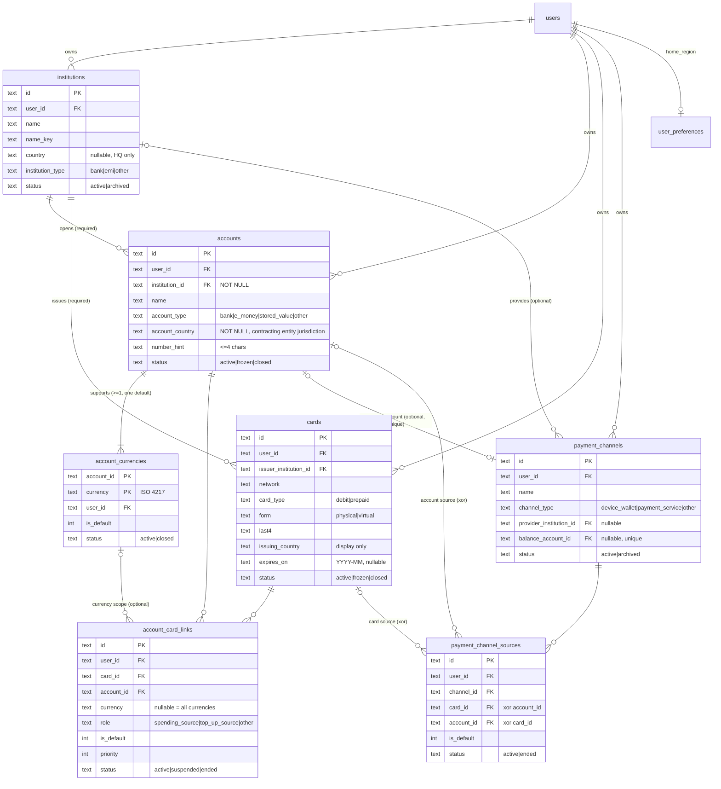

# X-UI Product v1 — 数据模型（DATA_MODEL）

> 状态：M1 表已实现；**M2 表已由迁移 `0001_m2_accounts` 实现（M2-B1，含 B1 加固：`user_preferences`、审计保留策略、`expires_on`、余额账户触发器），M2 API 尚未实现**。
> 相关文档：[PRODUCT_SPEC.md](PRODUCT_SPEC.md) · [API_SPEC.md](API_SPEC.md) · [TEST_PLAN.md](TEST_PLAN.md)

## 1. 通用约定

- 数据库：本地 `data/x-ui-v1.db`（libsql），Cloudflare 预留 D1 `x-ui-v1`。迁移记录表 `__xui_v1_migrations`；每次启动先做数据库身份检查（`xui_v1_meta.db_identity = x-ui-product-v1`），再执行迁移。
- 主键 `id`：text，可按时间排序的随机 id。时间戳：epoch 毫秒（integer）。业务日期：`YYYY-MM-DD`（text）。年月：`YYYY-MM`（text）。布尔：integer 0/1。
- 每张业务表都有 `user_id`（→ `users.id`，`ON DELETE CASCADE`），所有查询按 `user_id` 限定；访问他人数据一律返回 404。
- **跨用户关联在数据库层禁止**：被引用的业务表都有 `UNIQUE(id, user_id)`，所有业务引用都用包含 `user_id` 的复合外键（见 §4）。
- 枚举同时以数据库 `CHECK` 与 zod 枚举约束；信用卡、投资类型在数据库层无法写入。
- 国家/地区：ISO 3166-1 alpha-2；币种：ISO 4217（排除 XAU、XAG、XPT、XPD、XTS、XXX 等非流通代码）。清单放在 `@xui/ledger-shared`。
- `name_key`：名称规范化值 = NFKC → trim → 连续空白合并为一个空格 → 小写，用于重名判断。
- 兼容 D1：不使用交互式事务，多行写入用 `db.batch()`（原子）；单条语句不超过 100 个绑定参数。
- 外键要求 `PRAGMA foreign_keys = ON`（M1 的连接已开启；D1 默认强制外键）。

## 2. M1 已有表（不变）

| 表 | 说明 |
|---|---|
| `xui_v1_meta` | 数据库身份标记 |
| `users`、`passkeys`、`sessions`、`recovery_codes`、`login_attempts`、`auth_challenges`、`audit_log` | 认证，与旧版结构兼容 |
| `settings` | 键值设置（`key` 主键，`value` JSON，`updated_at`） |

`settings` 只保存实例级（全局）设置，**不保存任何用户个人设置**。用户的 `home_region` 保存在 `user_preferences`（§3.0），每个用户独立。

`audit_log` 保持 M1 结构不变（`user_id` 无外键），其保留策略见 §6.1。

## 3. M2 表定义

### 3.0 `user_preferences` 用户个人设置

| 字段 | 类型 | 空 | 默认 | 约束 / 说明 |
|---|---|---|---|---|
| user_id | text | 否 | | 主键；→ users（CASCADE） |
| home_region | text | 否 | `'CN'` | 用户本国地区，ISO alpha-2；`CHECK(home_region GLOB '[A-Z][A-Z]')` |
| created_at, updated_at | integer | 否 | | |

每个用户至多一行；没有记录时按默认值（`CN`）处理，首次修改时创建。修改只影响之后新建的 M3 流水（M3 保存快照），不回写历史。

### 3.1 `institutions` 金融机构

| 字段 | 类型 | 空 | 默认 | 约束 / 说明 |
|---|---|---|---|---|
| id | text | 否 | | 主键 |
| user_id | text | 否 | | → users（CASCADE） |
| name | text | 否 | | 1–80 字符 |
| name_key | text | 否 | | 规范化名称 |
| country | text | 是 | | 注册地/总部；`CHECK(country IS NULL OR country GLOB '[A-Z][A-Z]')` |
| institution_type | text | 否 | | `CHECK IN ('bank','emi','other')` |
| website | text | 是 | | `https://…`，≤200；仅展示，服务端从不访问 |
| color | text | 是 | | `#rrggbb`（头像底色，代替 logo） |
| notes | text | 是 | | ≤1000，敏感扫描 |
| status | text | 否 | `'active'` | `CHECK IN ('active','archived')` |
| sort | integer | 否 | 0 | |
| created_at, updated_at | integer | 否 | | |

索引：`UNIQUE(id, user_id)`；`UNIQUE(user_id, name_key, ifnull(country, ''))`；`INDEX(user_id, status)`。

### 3.2 `accounts` 持有资金的账户

| 字段 | 类型 | 空 | 默认 | 约束 / 说明 |
|---|---|---|---|---|
| id | text | 否 | | 主键 |
| user_id | text | 否 | | → users（CASCADE） |
| institution_id | text | **否** | | `(institution_id, user_id)` → institutions（见 §4） |
| name | text | 否 | | 1–80 |
| name_key | text | 否 | | 规范化名称（仅用于搜索与重名提示，不唯一） |
| account_type | text | 否 | | `CHECK IN ('bank','e_money','stored_value','other')` |
| deposit_kind | text | 是 | | `CHECK IN ('current','savings','fixed','other')`；`CHECK(deposit_kind IS NULL OR account_type = 'bank')` |
| account_country | text | **否** | | **开户合同所属金融机构法律实体所在法域**；`CHECK(account_country GLOB '[A-Z][A-Z]')` |
| number_hint | text | 是 | | 账号尾号，`CHECK(number_hint IS NULL OR (length(number_hint) BETWEEN 1 AND 4 AND number_hint NOT GLOB '*[^0-9A-Za-z]*'))` |
| status | text | 否 | `'active'` | `CHECK IN ('active','frozen','closed')` |
| opened_on, closed_on | text | 是 | | `YYYY-MM-DD`；`CHECK(closed_on IS NULL OR opened_on IS NULL OR closed_on >= opened_on)` |
| notes | text | 是 | | ≤1000，敏感扫描 |
| sort | integer | 否 | 0 | |
| created_at, updated_at | integer | 否 | | |

索引：`UNIQUE(id, user_id)`；`INDEX(user_id, status)`；`INDEX(user_id, institution_id)`；`INDEX(user_id, account_country)`。

**明确不存在的字段**：`balance`、`opening_balance`、`balance_date`、`credit_limit`、`include_in_total`、任何金额字段、完整账号。

**`institution_id` 创建后不可修改**：`PATCH /accounts/:id` 不接受 `institutionId`（未知字段 → 400 `VALIDATION`，服务层 `accountPatchValues` 只写入允许的列）；数据库触发器 `accounts_institution_immutable`（`BEFORE UPDATE OF institution_id`，值确有变化时 `RAISE(ABORT, 'ACCOUNT_INSTITUTION_IMMUTABLE: …')`）兜底，绕过服务层的 ORM 或原始 SQL 更新同样被拒绝（SQLite 与 D1 均验证）。删除（包括删除用户时的级联删除）不是更新，不受影响。开户法律实体发生变化时创建新账户，历史流水继续指向旧账户。

`account_country` 判定规则（冻结）：以账户协议与实际开户实体为依据；不是合作银行存放资金的地点；不从机构总部、银行卡发行国家、币种收款账户信息推断；一个账户只有一个值；开户实体变更时新建账户而非改写旧账户。

### 3.3 `account_currencies` 账户支持的币种

选用关联表而非 JSON 数组：可被复合外键引用（关联、M3 流水）、可查询"哪些账户持有某币种"、可单独关闭某币种。

| 字段 | 类型 | 空 | 默认 | 约束 |
|---|---|---|---|---|
| account_id | text | 否 | | `(account_id, user_id)` → accounts（CASCADE） |
| user_id | text | 否 | | → users（CASCADE） |
| currency | text | 否 | | `CHECK(currency GLOB '[A-Z][A-Z][A-Z]')` + ISO 清单 |
| is_default | integer | 否 | 0 | `CHECK IN (0,1)` |
| status | text | 否 | `'active'` | `CHECK IN ('active','closed')`；`CHECK(is_default = 0 OR status = 'active')` |
| sort | integer | 否 | 0 | |
| created_at | integer | 否 | | |

主键 `(account_id, currency)`；`UNIQUE(account_id, user_id, currency)`（复合外键的目标）；`UNIQUE(account_id) WHERE is_default = 1`。
API 保证：每个账户至少一个币种，恰好一个默认币种（且为 active）。无余额字段。

### 3.4 `cards` 银行卡

| 字段 | 类型 | 空 | 默认 | 约束 / 说明 |
|---|---|---|---|---|
| id | text | 否 | | 主键 |
| user_id | text | 否 | | → users（CASCADE） |
| issuer_institution_id | text | 否 | | `(issuer_institution_id, user_id)` → institutions |
| name | text | 否 | | 1–80，敏感扫描 |
| network | text | 否 | | `CHECK IN ('visa','mastercard','amex','unionpay','jcb','discover','diners','maestro','other')` |
| card_type | text | 否 | | `CHECK IN ('debit','prepaid')` —— 数据库层禁止信用卡 |
| form | text | 否 | `'physical'` | `CHECK IN ('physical','virtual')` |
| last4 | text | 否 | | `CHECK(last4 GLOB '[0-9][0-9][0-9][0-9]')` |
| issuing_country | text | 否 | | ISO alpha-2；仅展示，**不得用于推断资金所在地** |
| expires_on | text | 是 | | `YYYY-MM`，月份 01–12；`CHECK(expires_on IS NULL OR expires_on GLOB '[0-9][0-9][0-9][0-9]-0[1-9]' OR expires_on GLOB '[0-9][0-9][0-9][0-9]-1[0-2]')` |
| status | text | 否 | `'active'` | `CHECK IN ('active','frozen','closed')` |
| notes | text | 是 | | ≤1000，敏感扫描 |
| sort | integer | 否 | 0 | |
| created_at, updated_at | integer | 否 | | |

索引：`UNIQUE(id, user_id)`；`INDEX(user_id, status)`；`INDEX(user_id, issuer_institution_id)`。

**明确不存在的字段**：`account_id`、`pan`、`pan_enc`、`bin`、`bin_info`、`cvv`、`pin`、`holder_name`、`credit_limit`、`statement_day`、`due_day`。

### 3.5 `account_card_links` 银行卡-账户关联（多对多）

| 字段 | 类型 | 空 | 默认 | 约束 / 说明 |
|---|---|---|---|---|
| id | text | 否 | | 主键 |
| user_id | text | 否 | | → users（CASCADE） |
| card_id | text | 否 | | `(card_id, user_id)` → cards（CASCADE） |
| account_id | text | 否 | | `(account_id, user_id)` → accounts（CASCADE） |
| currency | text | 是 | | 空 = 适用于账户所有币种；非空时 `(account_id, user_id, currency)` → account_currencies |
| role | text | 否 | `'spending_source'` | `CHECK IN ('spending_source','top_up_source','other')` |
| is_default | integer | 否 | 0 | `CHECK(is_default = 0 OR (role = 'spending_source' AND status = 'active'))` |
| priority | integer | 是 | | 扣款顺序，1 最先；`CHECK(priority IS NULL OR priority >= 1)` |
| status | text | 否 | `'active'` | `CHECK IN ('active','suspended','ended')` |
| started_on, ended_on | text | 是 | | `YYYY-MM-DD`；`CHECK(ended_on IS NULL OR status = 'ended')` |
| notes | text | 是 | | ≤1000，敏感扫描 |
| created_at, updated_at | integer | 否 | | |

索引：
- `UNIQUE(card_id, account_id, ifnull(currency, ''), role) WHERE status <> 'ended'` —— 同一组合不能有两条未结束关联；结束后可重新关联。
- `UNIQUE(card_id, ifnull(currency, '')) WHERE is_default = 1` —— 每张卡每个币种范围至多一个默认消费来源。
- `INDEX(user_id, card_id)`；`INDEX(user_id, account_id)`。

用途定义：
- `spending_source`：刷卡消费时扣款的账户。**预付卡的储值账户是该卡的 `spending_source`。**
- `top_up_source`：为卡（或其储值账户）充值的账户。不可设为默认消费来源。
- `other`：其他关系，仅作记录。

生命周期：创建 → `active` ⇄ `suspended` → `ended`（"解除关联"，保留历史，不可恢复，需重新建立）。`DELETE` 仅用于纠正误录。账户、银行卡状态变化**不修改**关联的状态或默认标记；默认来源查找在读取时过滤状态（§5）。

### 3.6 `payment_channels` 支付渠道

| 字段 | 类型 | 空 | 默认 | 约束 / 说明 |
|---|---|---|---|---|
| id | text | 否 | | 主键 |
| user_id | text | 否 | | → users（CASCADE） |
| name | text | 否 | | 1–80，敏感扫描 |
| name_key | text | 否 | | `UNIQUE(user_id, name_key)` |
| channel_type | text | 否 | | `CHECK IN ('device_wallet','payment_service','other')` |
| provider_institution_id | text | 是 | | `(provider_institution_id, user_id)` → institutions |
| balance_account_id | text | 是 | | `(balance_account_id, user_id)` → accounts；`CHECK(balance_account_id IS NULL OR channel_type = 'payment_service')` |
| region | text | 是 | | 服务账户注册地区，仅展示；ISO alpha-2 |
| status | text | 否 | `'active'` | `CHECK IN ('active','archived')` |
| notes | text | 是 | | ≤1000，敏感扫描 |
| sort | integer | 否 | 0 | |
| created_at, updated_at | integer | 否 | | |

索引：`UNIQUE(id, user_id)`；`UNIQUE(user_id, name_key)`；`UNIQUE(balance_account_id) WHERE balance_account_id IS NOT NULL`；`INDEX(user_id, status)`。

余额账户的 `account_type` 须为 `e_money` 或 `stored_value`：API 校验（400 `BALANCE_ACCOUNT_KIND`），数据库由三个触发器兜底（SQLite 与 D1 均验证）：
- `payment_channels_balance_kind_insert`：INSERT 渠道时检查；
- `payment_channels_balance_kind_update`：UPDATE 渠道的 `balance_account_id` 或 `user_id` 时检查；
- `accounts_balance_kind_update`：被用作余额账户的账户不能改为其他类型（先解除余额账户）。

违反时 `RAISE(ABORT, 'BALANCE_ACCOUNT_KIND: …')`。账户不存在或属于其他用户时触发器不触发，由复合外键拒绝。

转账方式（SWIFT、FPS、SEPA 等）不是支付渠道，属于 M3 交易模型。

### 3.7 `payment_channel_sources` 支付渠道资金来源

| 字段 | 类型 | 空 | 默认 | 约束 / 说明 |
|---|---|---|---|---|
| id | text | 否 | | 主键 |
| user_id | text | 否 | | → users（CASCADE） |
| channel_id | text | 否 | | `(channel_id, user_id)` → payment_channels（CASCADE） |
| card_id | text | 是 | | `(card_id, user_id)` → cards（CASCADE） |
| account_id | text | 是 | | `(account_id, user_id)` → accounts（CASCADE） |
| is_default | integer | 否 | 0 | `CHECK(is_default = 0 OR status = 'active')` |
| status | text | 否 | `'active'` | `CHECK IN ('active','ended')` |
| notes | text | 是 | | ≤1000，敏感扫描 |
| created_at, updated_at | integer | 否 | | |

约束：`CHECK((card_id IS NULL) <> (account_id IS NULL))`；`UNIQUE(channel_id, card_id) WHERE card_id IS NOT NULL AND status = 'active'`；`UNIQUE(channel_id, account_id) WHERE account_id IS NOT NULL AND status = 'active'`；`UNIQUE(channel_id) WHERE is_default = 1`；`INDEX(user_id, channel_id)`。
API 规则：`device_wallet` 的来源只能是银行卡。

## 4. 复合外键矩阵（数据隔离）

所有业务引用都包含 `user_id`，父表侧有对应唯一键。即使应用层校验遗漏，数据库也拒绝跨用户关联。

| 子表 | 子列 | 父表（唯一键） | ON DELETE |
|---|---|---|---|
| user_preferences | user_id | users(id) | CASCADE |
| institutions | user_id | users(id) | CASCADE |
| accounts | (institution_id, user_id) | institutions(id, user_id) | NO ACTION |
| account_currencies | (account_id, user_id) | accounts(id, user_id) | CASCADE |
| cards | (issuer_institution_id, user_id) | institutions(id, user_id) | NO ACTION |
| account_card_links | (card_id, user_id) | cards(id, user_id) | CASCADE |
| account_card_links | (account_id, user_id) | accounts(id, user_id) | CASCADE |
| account_card_links | (account_id, user_id, currency) | account_currencies(account_id, user_id, currency) | NO ACTION |
| payment_channels | (provider_institution_id, user_id) | institutions(id, user_id) | NO ACTION |
| payment_channels | (balance_account_id, user_id) | accounts(id, user_id) | NO ACTION |
| payment_channel_sources | (channel_id, user_id) | payment_channels(id, user_id) | CASCADE |
| payment_channel_sources | (card_id, user_id) | cards(id, user_id) | CASCADE |
| payment_channel_sources | (account_id, user_id) | accounts(id, user_id) | CASCADE |

此外，上表每个子表都有自己的 `user_id → users(id) ON DELETE CASCADE`。

说明：
- **限制删除用 `NO ACTION`，不用 `RESTRICT`。** `RESTRICT` 在父行删除的瞬间检查，会与同一语句中的级联删除冲突（例如删除用户时级联删除机构，而账户尚未被级联删除；或删除账户时级联删除币种，而关联尚未被级联删除）。`NO ACTION` 在语句结束时检查，级联完成后不再有残留引用即通过；单独删除仍被引用的父行则失败。API 在删除前先检查引用并返回 409，数据库约束是最后防线。
- **复合外键只配合 `CASCADE` 或 `NO ACTION`**，不使用 `SET NULL`（会把 `user_id` 一并置空，违反 NOT NULL）。
- 子列中任一列为 NULL 时（如 `currency`、`card_id`、`provider_institution_id`），SQLite 不检查该外键（MATCH SIMPLE），符合"可选引用"的语义。
- 删除行为汇总：
  - 机构：被账户、银行卡、支付渠道引用时不可删除 → 归档。
  - 账户：级联删除其币种、银行卡关联、渠道来源；被支付渠道用作余额账户时不可删除；M3 起被流水引用时不可删除 → 关闭。
  - 银行卡：级联删除其关联、渠道来源；M3 起被流水引用时不可删除 → 关闭。
  - 账户币种：被关联引用时不可删除 → 关闭该币种。
  - 支付渠道：级联删除其来源；M3 起被流水引用时不可删除 → 归档。
  - 用户：v1 不提供删除用户的接口；在数据库层删除用户时，所有带 `user_id → users(id) ON DELETE CASCADE` 的表（认证表、`user_preferences` 与 M2 表）中该用户的记录全部级联删除，不影响其他用户，且删除后 `PRAGMA foreign_key_check` 为空；`audit_log` 按 §6.1 保留（TEST_PLAN D-3）。
- 关闭与删除的区别：
  - 关闭/冻结账户、关闭账户币种、冻结/关闭银行卡**不修改任何关联**（状态与默认标记保留，历史可查），只是这些来源不再被推荐（§5）；恢复有效后重新可被推荐。
  - 删除只用于没有历史意义的记录；被余额渠道或（M3 起）历史流水引用的账户不能删除。

## 5. 默认消费来源推荐（只读，供 M3 预填）

输入：银行卡 `card`、**Event 消费币种** `C`。
输出：三种结果之一 —— `exact_currency`、`conversion_required`、`no_match`。

```
if card.status != 'active':
    return { match: 'no_match', eventCurrency: C, reason: 'card_inactive' }

-- 合格：银行卡（上一步）、关联、账户、币种的状态全部有效
eligible(link) :=
      link.role   = 'spending_source'
  AND link.status = 'active'
  AND account(link).status = 'active'
  AND scope(link) is not empty

-- 关联可用的扣款币种（只含 active 币种）
scope(link) :=
  [link.currency]                         if link.currency IS NOT NULL and that account currency is active
  []                                      if link.currency IS NOT NULL and that account currency is closed
  active currencies of account(link)      if link.currency IS NULL

rank := is_default DESC,
        (link.currency IS NOT NULL) DESC,   -- 币种专属关联优先于"所有币种"关联
        priority ASC NULLS LAST,
        created_at ASC

1. exact := eligible links where C ∈ scope(link), ordered by rank
   if exact not empty:
     return { match: 'exact_currency', eventCurrency: C,
              accountId, linkId, fundingCurrency: C }

2. conv := eligible links, ordered by rank
   if conv not empty:
     return { match: 'conversion_required', eventCurrency: C,
              accountId, linkId, fundingCurrency: null,
              candidateCurrencies: scope(link)   -- 账户默认币种排在最前，其余按 sort
            }

3. return { match: 'no_match', eventCurrency: C, reason: 'no_eligible_link' }
```

规则：
- **不把账户默认币种当作消费币种或扣款币种。** `conversion_required` 的 `fundingCurrency` 永远为 `null`；`candidateCurrencies` 只是候选，用户必须依据真实交易记录选择扣款币种并填写扣款金额（§8）。
- **币种一致优先于默认标记。** 任何合格的币种一致来源，都优先于需要换汇的默认来源。理由是多币种卡（如 Wise）通常优先扣同币种余额。这只是推荐，用户可以改。
- 冻结或关闭的银行卡、账户，已关闭的账户币种，以及暂停或已结束的关联，永远不会被推荐。被跳过的默认关联不报错，继续按顺序查找。
- 推荐结果不写入任何数据；M3 流水保存用户最终确认的值（§8）。

示例（Wise 多币种账户 + Wise 借记卡，一条"所有币种"默认关联）：

| 账户有效币种 | 消费币种 | 结果 |
|---|---|---|
| USD、EUR、GBP | USD | `exact_currency`：Wise · USD |
| HKD（默认）、EUR | USD | `conversion_required`：Wise，`fundingCurrency = null`，候选 `[HKD, EUR]` |
| HKD（默认）、EUR，账户已冻结 | USD | `no_match`（`no_eligible_link`） |
| 任意，银行卡已冻结 | 任意 | `no_match`（`card_inactive`） |

## 6. 敏感数据防护

1. 请求体使用 zod `.strict()`：出现未知字段（`pan`、`cardNumber`、`number`、`cvv`、`cvc`、`pin`、`bin` 等）→ 400。
2. 自由文本字段（所有 `name`、`notes`、`number_hint`）扫描：
   - 13–19 位数字（允许其间有空格或 `-`）且通过 Luhn 校验 → `400 SENSITIVE_DATA`；
   - `cvv|cvc|cvv2|pin|安全码|密码` 后接 3–6 位数字 → `400 SENSITIVE_DATA`。
   - **无绕过参数或确认选项。**
   - 实现（`@xui/ledger-shared` 的 `scanSensitive`，API 与前端共用）：先做 NFKC（全角数字同样命中）；数字组之间允许 1–2 个空格或 `-`，对连续若干组合计 13–19 位的每个组合做 Luhn 检查（"ref 12 4111 1111 1111 1111" 同样命中）；`cvv`/`cvc`/`cvv2`/`pin` 需为独立单词（"spin 1234" 不命中）。机构的 `website` 也做扫描。
3. 表结构中不存在 PAN、BIN、CVV、PIN、持卡人姓名、完整账号、余额相关列（由测试扫描 schema 保证）。
4. 不记录请求体日志；审计日志 detail 只含 id 与后四位。

### 6.1 审计日志保留策略

- `audit_log` 是独立的安全记录，表结构沿用 M1、不做修改；`user_id` 不设外键。
- **删除用户不删除其审计记录**：记录保留原 `user_id`（此后指向已不存在的用户），用于事后追查；不随用户、账户、银行卡等业务数据级联删除。
- v1 不自动清理审计记录；如需清理，只能作为单独的运维操作，不属于任何业务删除流程。
- 内容限制：只记录动作、相关 id、后四位、名称等非敏感信息与 IP；**不得包含**密码、TOTP 密钥或验证码、恢复码、会话令牌、加密密钥、PAN / CVV / PIN 或请求体（测试：`audit-retention.test.ts`）。
- 登录相关事件**不记录用户输入的原文**：`login.failure` 只记录 `{ via }`，已存在的账户通过 `user_id` 标识；`login.locked` 只记录触发的限制范围 `{ scopes: ['user', 'ip'] }`，不记录限流键的值（用户键含输入的用户名，可能是误输入的密码）。时间与 IP 由每条审计记录自带（测试：`audit-retention.test.ts` 用唯一的"金丝雀"字符串作为用户名验证）。
- 登录限流表 `login_attempts`（M1 表，结构不变）的按用户名计数键为 `user:<hex HMAC-SHA256(SESSION_PEPPER, "x-ui-v1/login-attempts/user:" + 小写用户名)>`，不保存输入的用户名原文；IP 计数键仍为 `ip:<IP>`（IP 不是凭证）。规范化（小写）、阈值（用户名 5 次 / IP 30 次）、15 分钟窗口与 15 分钟锁定均不变；轮换 `SESSION_PEPPER` 会重置按用户名的计数。

## 7. ER 图



## 8. M3 数据模型要求（Event / Entry 与历史完整性）

M3 的具体表名与其余字段在 M3 设计时确定；以下是 M2 对 M3 的硬性要求。暂称 `transaction_events`（Event）与 `transaction_entries`（Entry），一个 Event 至少一个 Entry。

### 8.1 Event：原始交易

| 字段 | 说明 |
|---|---|
| `event_currency` | 原始消费币种（ISO 4217），例如商户标价的 USD |
| `event_amount` | 原始金额（该币种最小单位整数） |
| `merchant_country` | 商户所在地（M3 定义） |
| `card_id` | 实际使用的银行卡（可空）；复合外键 `(card_id, user_id)` → cards，NO ACTION |
| `payment_channel_id` | 实际使用的支付渠道（可空）；复合外键 `(payment_channel_id, user_id)` → payment_channels，NO ACTION |
| `transfer_method` | 转账方式（SWIFT、FPS、SEPA 等，M3 定义；替代原 `bank_transfer` 渠道类型） |
| `home_region` | **快照**：保存时的 `home_region` |

### 8.2 Entry：资金实际变动

| 字段 | 说明 |
|---|---|
| `event_id` | 复合外键 `(event_id, user_id)` → events，CASCADE |
| `funding_account_id` | 真实资金来源账户；复合外键 `(funding_account_id, user_id)` → accounts，NO ACTION |
| `funding_currency` | **实际扣款币种**；复合外键 `(funding_account_id, user_id, funding_currency)` → account_currencies，NO ACTION |
| `amount` | **实际扣款金额**（`funding_currency` 最小单位整数）；可空 |
| `amount_status` | `CHECK IN ('confirmed','pending')`；`CHECK((amount IS NULL) = (amount_status = 'pending'))` |
| `funding_account_country` | **快照**：保存时该账户的 `account_country` |

示例（Wise 卡支付 10 USD，实际从 HKD 余额扣款）：

| 层 | 字段值 |
|---|---|
| Event | `event_currency = USD`，`event_amount = 1000`，`card_id = Wise Debit` |
| Entry | `funding_account_id = Wise 多币种账户`，`funding_currency = HKD`，`amount = 7830`（用户依据 Wise 记录填写），`amount_status = confirmed`，`funding_account_country = BE` |

### 8.3 规则

1. **不自动计算汇率与手续费**：不保存推算汇率，不生成换算合计；`event_amount` 与 `amount` 是两个独立事实。
2. Entry 币种与 Event 币种相同时，前端可预填 `amount = event_amount`，但仍分别保存。
3. 币种不同时，`amount` 由用户依据真实交易记录填写；未知时为 `pending`，不估算，不计入金额统计，单独列出待补录。
4. 金额统计与境外活动判断按 Entry（资金账户、币种、金额、`funding_account_country`）与 Event 快照（`home_region`、`merchant_country`）进行；Event 金额不另行计入统计，避免重复。
5. 默认来源推荐（§5）只用于新建时预填；`conversion_required` 时 `funding_currency` 必须由用户选择。保存后只读取流水自身字段，**不依据当前关联关系重算**。
6. 修改 `account_country`、修改 `home_region`、结束或删除关联、关闭账户/银行卡/币种，**不改变任何已保存的 Event、Entry 及其统计结果**；系统不会自动回写历史。
7. 被流水引用的账户、账户币种、银行卡、支付渠道不可删除（API 返回 409，只能关闭/归档）；对应外键使用 `NO ACTION`。

## 9. 迁移与实现注意

- 迁移 `0001_m2_accounts.sql` 只新建 §3 的八张表（含 `user_preferences`）、其索引与四个触发器（§3.6 的三个余额账户触发器、§3.2 的 `accounts_institution_immutable`），不修改 M1 表；仍经过 M1 的身份检查，只在 v1 数据库上执行。
- drizzle-kit 0.31 会把表达式索引列 `ifnull("col", '')` 拆开并加引号（"no such column"），且不支持触发器：0001 在生成后手工修正，文件头注明修改内容。`test/migrations-guard.test.ts` 扫描**所有** v1 迁移：引号标识符、表达式索引、括号、空语句、journal / SQL / 快照一致、wrangler 拆分结果与 drizzle 一致、整条迁移链可在空库执行且必需触发器存在。
- 表达式部分唯一索引（`ifnull(...)` + `WHERE`）与复合外键需在 M2-B 验证 drizzle-kit 的生成结果，必要时手工修改迁移 SQL，并以测试确认索引与约束确实生效。
- "设为默认"等多行更新使用 `db.batch()` 原子执行（先清除同范围旧默认，再设置新默认）；部分唯一索引作为最后防线。
- 共享 zod schema、DTO 类型、ISO 国家与币种清单放在新包 `packages/ledger-shared`（`@xui/ledger-shared`），不修改 `@z-ui/shared`。
- **SQLite 与 D1 双环境验证**：`NO ACTION`、`CASCADE`、复合外键、部分唯一索引、表达式索引、CHECK 与 `db.batch()` 原子性，必须在两个环境中用同一套用例验证（TEST_PLAN §3.12）：
  - 本地 SQLite：libsql 文件数据库，经 `openV1Db()`（身份检查 + 迁移），连接上已开启 `PRAGMA foreign_keys = ON`；
  - 本地 D1：wrangler `getPlatformProxy()` 启动的 workerd 内存 D1（`persist: false`、`remoteBindings: false`），迁移按 `_journal.json` 顺序、用 wrangler 的 SQL 拆分器逐条执行，与 `wrangler d1 migrations apply` 一致；**不连接远程 D1**。
  - 两个环境都先用一条明显非法的外键插入确认外键确实在强制执行，避免"约束未开启"导致的假通过。
